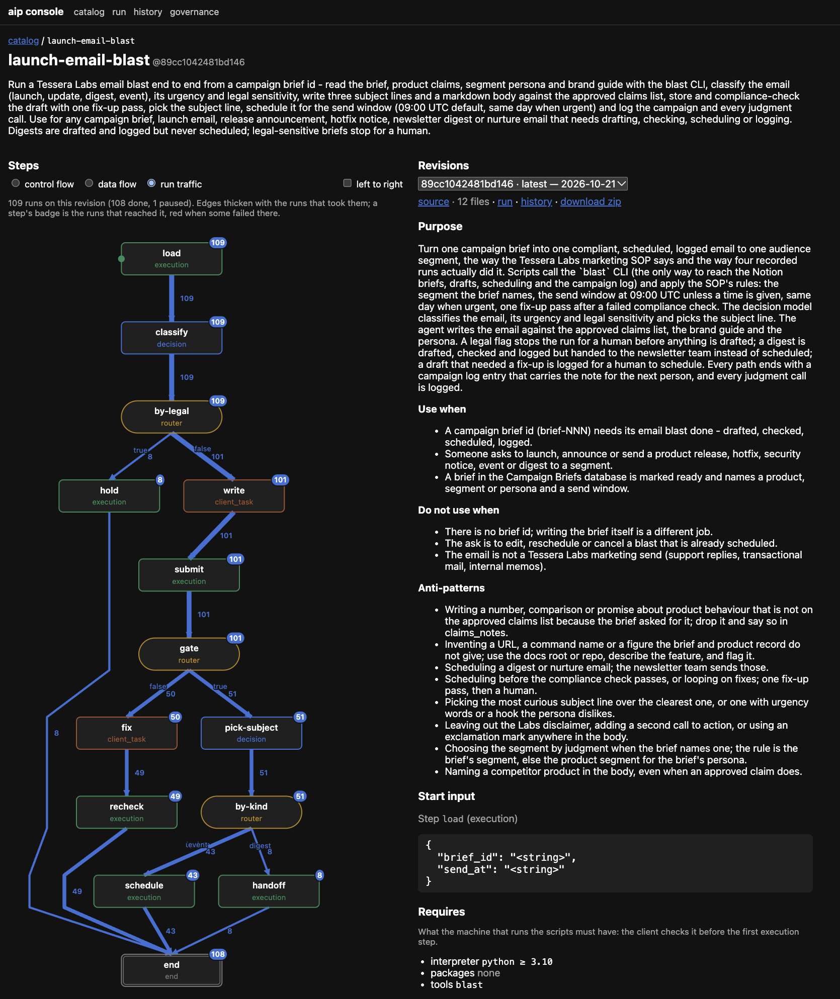
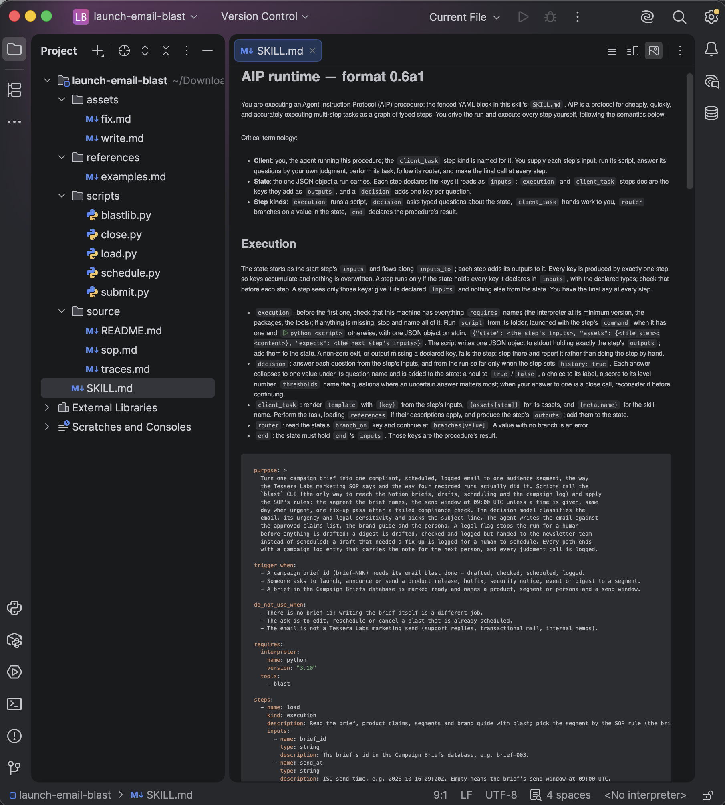
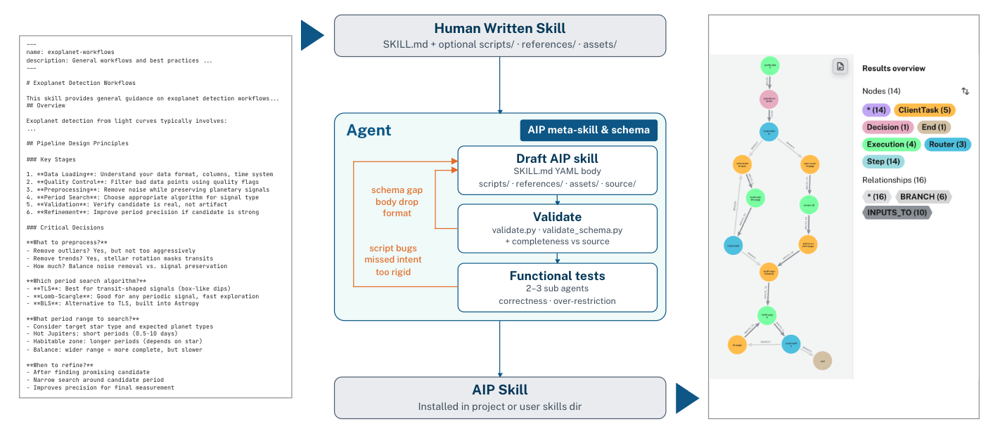
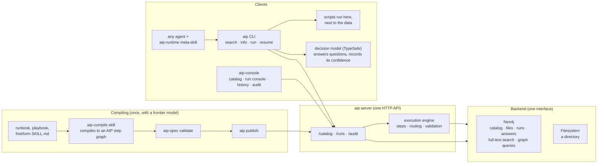

<table>
  <tr>
    <td width="200" align="center" valign="middle">
      
    </td>
    <td valign="middle">
      <h1>AIP — Agent Instruction Protocol</h1>
      <p><em>The open protocol for governed agent workflows</em></p>
    </td>
  </tr>
</table>

## What Is AIP?
Agent Instruction Protocol (AIP) is an open protocol for creating and running governed agent workflows.

AIP is used to distill domain knowledge into procedures that even small, inexpensive agents follow step by step, with explicit control flow and optional server-side recording for auditing every run.

As an open protocol, AIP works with any model, agent harness, or orchestration stack. It was designed for agentic AI, but an AIP client can be any application or a human operator.

Two open standards cover parts of this today. [Model Context Protocol (MCP)](https://modelcontextprotocol.io/) decouples tools, data, and other assets into a service any agent can call. [Agent Skills](https://agentskills.io/) represent procedural knowledge in a portable form that humans can read and maintain.

AIP fills the gap between them. It builds on Agent Skills, so a procedure stays a portable, human-readable skill, and adds what Skills lack: typed steps, explicit control flow, and a runtime any client can drive, the way MCP gave tools a service any agent can call. The result is predictability, portability, auditability, and lower cost for teams running autonomous agents.

Ex of an AIP procedure for marketing emails with historic runs. Visualized in the AIP console:\


## Contents

- [Key Concepts](#key-concepts)
- [How It Works](#how-it-works)
- [Research and Evidence So Far](#research-and-evidence-so-far)
- [Quick Start](#quick-start)
- [Project Structure](#project-structure)
- [End-to-End Walkthrough](#end-to-end-walkthrough)
- [Reference](#reference)
- [Development & Contributing](#development--contributing)

## Key Concepts

### Procedures

An AIP _procedure_ is an instance of step-by-step know-how: an executable graph-shaped workflow that guides an agent on how to perform a task using tools and logical sequences.

Procedures are direct extensions of Agent Skills, fully compatible with the [agent skills spec](https://agentskills.io/specification), and can even be used in the same way—by placing in a discoverable directory for the agent (see the [AIP specification](packages/aip-spec/docs/specification.md) in the format package, [`packages/aip-spec/`](packages/aip-spec/), for details). However, AIP also provides a runtime (this repo) that takes advantage of the graph structure to enforce control flow - sequenced workflows of tools and steps, with typed I/O contracts - as well as typed records for auditing each run. 

Ex of the marketing email procedure in its serialized agent skill format:



### Steps and State

A procedure's body is a YAML graph of typed steps, validated against the AIP schema. There are six step kinds:

| kind | what it does |
|---|---|
| `start` | holds the procedure's inputs, what the client supplies, and names the first step |
| `execution` | runs a script and adds its result to the state |
| `decision` | asks typed questions about the state (yes/no, a choice, a score); each answer becomes a value in the state, and the model's confidence in it can too |
| `client_task` | hands work to the client, with a rendered template and the outputs it must produce |
| `router` | branches on a value in the state, after checking a confidence if the author asked for one |
| `end` | declares which keys are the procedure's result |

The state is the one JSON object a run carries. Each step declares the keys it reads as `inputs` and the keys it adds as `outputs`, with their types; keys accumulate, and a later step may overwrite one.

### Procedure Distillation

Procedures can be written by hand, but the recommended workflow is to distill them from material that already exists. Most domain know-how is already written somewhere; just not in an executable form. It sits in runbooks and SOPs, policy documents, post-mortems and incident reviews, decision logs and design deliberations, existing freeform Agent Skills, wiki pages, ticket threads, etc. 

The `aip-compile` skill ([`skills/aip-compile/`](skills/aip-compile/), bundled with `aip-spec`) takes that material in whatever form it comes and compiles it, with a frontier model, into a step graph: each piece of know-how becomes a typed step, a question whose confidence a router can check, a router branch, a script, or a task handed to the client. The skill then runs `aip-spec validate` until the graph passes and walks the source line by line to confirm that nothing actionable was dropped; rules, cutoffs, lookups, and branching are never allowed to fall away, and anything left out on purpose is recorded with its rationale. The original material ships inside the skill under `source/`, so every procedure can be read against what it was compiled from, and compiled again when the source changes. Step 6 of the [walkthrough](#6-compile-and-publish-your-own-skill) does this end to end.



### Runtime Protocol

The runtime protocol is how a procedure gets executed. It defines the step types, the state that flows between steps, and the pauses where a client must act. AIP enforces this at three levels:

1. **In the skill itself.** Every AIP skill carries a fixed runtime block in its body, so any agent can follow the protocol itself, with no AIP tooling present, just as it would any Agent Skill.
2. **Locally.** The `aip` command runs a skill folder with an engine that enforces the protocol: it walks the graph, checks each step's inputs and outputs against their declared types, runs scripts, answers decisions, and follows routers.
3. **Client-server.** An `aip` server holds a catalog of published procedures and drives each run with the same engine, recording every step for auditing. Clients, whether an agent, an application, or a person, search the catalog, start runs, and act at pauses. Scripts run on the client, next to the data, never on the server.

In every mode the client only has to act at a pause: a task to perform, or a decision's questions to answer when no decision model is configured and the author allowed that.

## How It Works



The agent never decides anything the procedure can decide. It starts a run, and the server walks the graph: it validates each step's input and follows routers, while the `aip` client runs the scripts and asks the decision model. It stops only at a pause the agent must handle: a task to perform, or, with no decision model configured and the author's leave, a decision's questions. Nothing is put to the agent to confirm: a decision can write the model's confidence in an answer into the state, and a router checks it and sends an unsure run where the author says. Every step, answer, and pause is recorded against the revision that ran, which is what the history and governance views read.

## Research and Evidence So Far

Our research shows AIP lifting Claude Sonnet's task pass rate from 51% to 63% over the same skills as Agent Skills.

Our paper [AIP: A Graph Representation for Learning and Governing Agent Skills](https://arxiv.org/pdf/2606.04781), published at a VLDB 2026 workshop, measured the previous format (`0.3a3`, skills as structured YAML loaded into context, before the server existed) on a stratified core of 24 [SkillsBench](https://www.skillsbench.ai) tasks. Each task's human-curated skill was converted to AIP once by Claude Opus; Claude Sonnet 4.6 then solved the task with either the original or the conversion, five trials per task.

| Skill given to the solver | Pass rate | Mean reward |
|---|---|---|
| Human-curated Agent Skill | 50.8% | 0.567 |
| The same skill converted to AIP | **63.3%** | **0.668** |

Tool-call counts were about equal, and wall clock was lower on the AIP side in two of the three task cohorts. The format has moved on since (typed step kinds, declared inputs and outputs, a decision model whose confidence routers check, the runtime block, and a server that holds each run while the client runs its scripts and decisions); measuring this release the same way is the next study, and the harness is [aip-skillbench](https://github.com/zach-blumenfeld/aip-skillbench).

## Project Structure

One Python package lives in this repository, and the console is its own repository:

| package | where | what it holds | install |
|---|---|---|---|
| `agent-instruction-protocol` | this repo's root (`src/aip/`) | the `aip` command and Python SDK: the language's compiler (`aip compile`, `fmt`, `export`; `src/aip/compiler/`), the runtime, `aip server` with its backends, the skills ([`skills/`](skills/)) and the example programs ([`examples/`](examples/)). Through 0.8 the language was a second package, `aip-spec`; it is part of this one since 0.9 | `uv tool install "agent-instruction-protocol[server]"` |
| `aip-console` | [aip-console](https://github.com/zach-blumenfeld/aip-console) | the web console: catalog, run console, history, and audit views over a running `aip server` | `npx aip-console --server URL` |

## Quick Start
Minimal prerequisites. 

**1. Install or upgrade.** One command does both; re-run it any time.
```bash
curl -sSfL https://raw.githubusercontent.com/zach-blumenfeld/aip/main/install.sh | bash
```
Installs [uv](https://docs.astral.sh/uv/) if missing, the `aip` CLI with `aip-spec`, and both Agent Skills, `aip-compile` for compiling and `aip-runtime` for running, into every agent it detects (Claude Code, Cursor, Windsurf, Copilot, Gemini CLI, Cline, Codex, Pi, OpenCode, Junie). Open a new terminal afterwards if `aip` is not found.

**2. Run the example locally.** The bundled `billing-support` skill triages a customer message. With no decision model configured you answer its questions on the terminal: the example opts into that (`fallback: true` on its decision) so this step needs no TypeSafe key. An answer by hand carries no confidence and is not checked, so the tone you give picks the branch: `angry` runs the escalation script, `calm` pauses with a task for you to draft the reply. With a key the model answers, and the router escalates a tone it is unsure of.

```bash
aip-spec example billing-support --out .     # writes ./billing-support
aip info ./billing-support                   # what it does, the input it expects, how it flows
aip run ./billing-support --interactive
```

**3. Start a server and publish.** The filesystem backend is a directory and needs nothing else. Leave the server running in one terminal and publish from another.

```bash
aip server --backend filesystem              # terminal 1, http://localhost:8000
```

```bash
aip config --server http://localhost:8000    # terminal 2: where the client sends requests
aip publish ./billing-support                # validates, uploads, prints billing-support@<revision>
aip search "refund"
aip run billing-support --interactive        # the same run, now recorded on the server
```

**4. Let an agent run it.** The installer put the `aip-runtime` skill into your agent, and `aip config` pointed the `aip` command at your server. In Claude Code, ask:

```
A customer wrote: "I was charged twice! Refund me today or I'm gone." Handle it.
```

The agent searches the catalog, finds `billing-support`, starts the run, and handles each pause instead of improvising the steps.

**5. Compile your own.** Put a runbook, SOP, playbook, or existing `SKILL.md` in a folder and, in Claude Code, ask:

```
Author an AIP skill from ./refund-runbook.md
```

The `aip-compile` skill compiles it into a procedure, validates it, and checks nothing was dropped. Then `aip publish ./<name>` puts it on the server. Use the largest model you have for this step; see below.

Optional: `aip config --decision-model-key KEY` with a [TypeSafe](https://typesafe.ai) key has a decision model answer the questions in steps 2 to 4 and record its confidence; the example's router checks that confidence in the tone and escalates an unsure one, so only a confidently calm message reaches the reply task. The [End-to-End Walkthrough](#end-to-end-walkthrough) repeats these steps on a Neo4j-backed server with the web console and shows the procedure and run graphs in Cypher.

### Other ways to install

```bash
uv tool install "agent-instruction-protocol[server]"     # the `aip` command with `aip server`; the compiler is part of it
pip install "agent-instruction-protocol[server]"         # into a virtualenv instead of uv's tool directory
aip skill install                   # both skills, every detected agent
aip skill install claude-code       # one agent;  aip skill list  shows them
aip skill install --path ./.claude/skills    # a project-local skills directory
aip skill remove
```

### Model Recommendation for Compiling

Use the **largest frontier model available** when using the `aip-compile` skill. The work is cognitively intense and underrepresented in current training data — smaller models struggle.

For *consuming* the resulting skill, the opposite holds: AIP's structure is what makes smaller, cheaper models more competitive on workflow-heavy tasks.

## End-to-End Walkthrough

Extended example with Neo4j backend for deeper audit and governance. 

### Prerequisites

- macOS or Linux with `curl`.
- A Neo4j database. [Aura](https://console.neo4j.io) works.
- A [TypeSafe](https://typesafe.ai) API key, set on the client. Optional: without it, every decision step pauses and asks you/agent to answer instead of a decision model (the example allows that with `fallback: true`), and an answer by hand takes the branch you chose, unchecked.
- [Claude Code](https://claude.com/claude-code) for steps 5 and 6. Any agent `aip skill list` names works the same way.

### 1. Install or upgrade

```bash
curl -sSfL https://raw.githubusercontent.com/zach-blumenfeld/aip/main/install.sh | bash
```

That installs [uv](https://docs.astral.sh/uv/) if missing, then two commands, `aip-spec` (the format and validator) and `aip` (runtime, server, client), and puts two Agent Skills into every agent it detects: `aip-compile` for compiling and `aip-runtime` for running published procedures. Check:

```bash
aip --help
aip skill list          # which agents got the skills
```

If `aip` is not found, open a new terminal. uv installs commands into `~/.local/bin`.

### 2. Start a server on Neo4j, with the example published

```bash
aip server --init       # writes ~/.config/aip/server.toml, every setting commented
```

Open that file and set 5 lines. 

Under `[backend]`:
```toml
kind = "neo4j"
uri = "neo4j+s://xxxxxxxx.databases.neo4j.io"   # from Aura
user = "neo4j"
password = "..."
database = "neo4j"
```

Then start the aip server:

```bash
aip server
```
Leave it running. In a second terminal you will publish an AIP skill to the server. 
You will use the hello-world example for now.  Later you will see how to compile your own. 

```bash
aip config --server http://localhost:8000      # where the client and the agents send requests
aip config --decision-model "..."              # your TYPESAFE_API_KEY: optional but highly recommended
aip-spec example billing-support --out .       # the bundled example skill, written to ./billing-support
aip publish billing-support                    # validates, uploads, prints billing-support@<revision>
```

`aip publish <folder>` is how any skill gets onto the server. `aip list` shows the catalog.

### 3. The console

The console is a separate npm package from its own repository, [aip-console](https://github.com/zach-blumenfeld/aip-console); the server serves no UI. In another
terminal, start it against the server and open the URL it prints:

```bash
npx aip-console --server http://localhost:8000
```

Four tabs across the top plus the server link at the right:

- **catalog**: every published name with its step graph drawn. Click `billing-support` for the procedure page: purpose, triggers, each step with its inputs and questions, the files it ships (source viewer), the diff between any two revisions, and the governance controls (pin a revision, retire one).
- **run**: the run console. Pick a procedure, fill the start input, start. The console walks the steps and stops at every pause for you to answer: a task it needs the client to do, or the questions themselves when there is no model and the decision allows it.
- **history**: every run, step by step, with what each step got and produced.
- **audit**: corpus queries across all runs: routes where a router's confidence check fired and why, routers an unmeasured source steers and the runs that went through them, decisions answered by hand, scripts that failed (with the client's stderr), skills missing fields, branches no run has taken.
- **server link** (top right): the server URL and bearer token the page uses.

Try two runs of `billing-support`. Message `I was charged twice this month and I am furious, fix it or I cancel`: the model marks it billing and angry (with no decision-model key, you answer the two questions on the page), the router sends it to the escalation script, which runs on your machine, and the run ends; its ticket id and the tier2 queue are on the escalate step in the history tab. Message `Hi, could you tell me whether my March invoice was a duplicate?`: the model is confident it is calm, so the run pauses with a client task asking you to draft the reply from the policy; type one and the run ends, with your reply recorded on the reply step. The router checks the model's confidence in the tone before it branches (`tone_confidence`, written by the decision), and sends an unsure run, or one with no confidence recorded because you answered by hand, to the escalation script too; the history shows the check firing and why on the router step.

### 4. See it in Neo4j

Open your database in Neo4j Browser or Query and run these. The skill and its procedure graph:

```cypher
MATCH (n:Name {name: 'billing-support'})-[:HAS_REVISION]->(s:Skill)-[:HAS_PROCEDURE]->(p:Procedure)
MATCH p1 = (p)-[:HAS_STEP]->(st:Step)
OPTIONAL MATCH p2 = (st)-[:NEXT|THEN]->(:Step)
OPTIONAL MATCH p3 = (st)-[:ASKS]->(:Question)
RETURN n, s, p, p1, p2, p3
```

Or just the control flow, from the start step to the end, with each router's condition on its `THEN` edge and its confidence check on a `BELOW {key, below}` edge:

```cypher
MATCH (n:Name {name: 'billing-support'})-[:HAS_REVISION]->(s:Skill)-[:HAS_PROCEDURE]->(p:Procedure)
MATCH controlFlow = (p)-[:STARTS_AT]->(:Step)-[:NEXT|THEN|BELOW*]->(:Step)
RETURN controlFlow
```

The data flow is a second edge set over the same steps: one `Data` node per key, `PRODUCES` from every step that writes it (an output, the decision whose question it answers, or the decision that emits its confidence), `FEEDS` into every step that reads it (a router's check included), and `SUPPLIES` from the procedure for the start inputs the client provides. Follow a value from the client to the result:

```cypher
MATCH (n:Name {name: 'billing-support'})-[:HAS_REVISION]->(s:Skill)-[:HAS_PROCEDURE]->(p:Procedure)
MATCH dataFlow = (p)-[:SUPPLIES]->(:Data)-[:FEEDS|PRODUCES*]->()
RETURN dataFlow
```

Every run of the skill, with the steps they ran and, for decisions a model answered, its answers (`Answer` nodes; a decision answered by hand has none, and its answers are on the `StepRun`):

```cypher
MATCH (r:Run {name: 'billing-support'})-[:OF_SKILL]->(s:Skill)
MATCH p1 = (r)-[:STEP_RUN]->(sr:StepRun)
OPTIONAL MATCH p2 = (sr)-[:FOLLOWED_BY]->(:StepRun)
OPTIONAL MATCH p3 = (sr)-[:OF_STEP]->(:Step)
OPTIONAL MATCH p4 = (sr)-[:ANSWERED]->(:Answer)-[:OF_QUESTION]->(:Question)
RETURN r, s, p1, p2, p3, p4
```

Just the run trails, when that gets busy:

```cypher
MATCH p = (r:Run {name: 'billing-support'})-[:STEP_RUN]->(:StepRun)-[:FOLLOWED_BY*0..]->(:StepRun)
RETURN p
```

Every file of every revision is also in there as `File` nodes with exact bytes; `aip get billing-support --out ./restored` rebuilds the folder from them and verifies the hashes.

### 5. Run it through an agent

The installer put the `aip-runtime` skill into Claude Code if it found it so you should be able to just ask the below to see it work:

- `A customer wrote: "I was charged twice! Refund me today or I'm gone." Handle it.`
- `A customer asks politely whether they can still get a refund on a subscription they forgot to cancel last month. Deal with it.`

`aip skill list` shows `installed`, and if not, `aip skill install claude-code` does it now. Step 2 pointed the `aip` command at your server with `aip config`. The agent never learns the URL; the skill tells it to run `aip search`, `aip run`, and `aip resume`, and those read the config.

Watch it search the catalog, find `billing-support`, start the run, and answer each pause ([`docs/examples/aip-runtime-session.md`](docs/examples/aip-runtime-session.md) is a recorded session; an agent may also skip the skill and improvise, so if it does, ask again naming the catalog). The first ends in a tier2 ticket opened by the skill's script, which `aip` ran on your machine. The second, with a decision-model key on the client, pauses with a client task, and the agent drafts the reply itself; without a key the agent answers the questions, its answer carries no confidence, and the router escalates that one too. Both runs then appear in the console's history tab and in the Cypher above. Ask it to run something unrelated and it should say the catalog has nothing for it rather than improvise.

### 6. Compile and publish your own skill

The `aip-compile` skill turns a document into a procedure. Put the material in a folder: a runbook in markdown, an existing freeform `SKILL.md`, a support playbook, anything with steps and decisions. Use the largest model you have; this is the hard part. In Claude Code, from that folder:

```
Author an AIP skill from ./refund-runbook.md
```

The agent asks you to pick a name, scaffolds `./<name>/` with your document under `source/`, writes `SKILL.md` as a step graph (decisions with questions, scripts, tasks for the client, routers), runs `aip-spec validate` until it passes, then walks your source line by line checking nothing was dropped. Then:

```bash
aip validate ./<name>                    # the same checks, any time
aip info ./<name>                        # what it does, the input it expects, how it flows
aip run ./<name> --interactive           # try running locally first: no server, answers on the terminal
aip publish ./<name>                     # then onto the server, where agents find it; refresh the console
```

Edit, validate, publish again: the same name gets a new revision, and the console's diff shows what changed. Pin a revision when the catalog should resolve to it regardless of what is published later.

## Reference

The pieces behind the walkthrough, for looking things up rather than reading through: the two Agent Skills the installer writes, the `aip` command and the Python SDK under it, and how a skill folder becomes a published revision.

### The Two Agent Skills

The installer puts two Agent Skills into your agent, both written by `aip skill install`:

1. **`aip-compile`** from [`skills/aip-compile/`](skills/aip-compile/) (bundled with `aip-spec`). Bring source material (or describe it); the agent compiles it into a procedure, validates it against the schema, runs it, and tests it. It also validates an existing skill folder on request, with `aip-spec validate` (or `aip validate`, the same checks). Details in [`SKILL.md` § Authoring an Agent Skill](skills/aip-compile/SKILL.md#authoring-an-agent-skill) and [§ Validating an AIP Skill](skills/aip-compile/SKILL.md#validating-an-aip-skill).
2. **`aip-runtime`** from this repo ([`skills/aip-runtime/SKILL.md`](skills/aip-runtime/SKILL.md)). The one page an agent reads to search the catalog and run a published procedure through the `aip` client instead of doing the steps by hand. `aip runtime --skill --out <skills dir>` writes it alone.

### Running a Skill

```bash
aip info <path/to/skill-folder>                       # what it does, the input it expects, how it flows
aip info <path/to/skill-folder> --example-input > start.json   # a start input to edit
aip run <path/to/skill-folder> --input start.json     # runs until the client must decide
aip resume <run-id> --input answer.json              # continues a paused run, from any directory
aip run <path/to/skill-folder> --interactive           # prompts on the terminal instead
```

With a server (`aip server --backend filesystem|neo4j`, see [`docs/server-design.md`](docs/server-design.md)), the same commands take a published name, and the catalog has its own:

```bash
export AIP_SERVER=http://localhost:8000               # or: aip config --server URL [--token T]
aip publish <path/to/skill-folder>                     # validate, upload, prints name@revision
aip search "refund"                                    # ranked by the server
aip list                                               # every name with the revision it resolves to
aip info <name> --example-input > start.json
aip run <name> --input start.json                      # runs on the server; same pause and resume
aip get <name>[@revision] --out ./restored             # the folder back, hash-verified and validated
aip pin <name>@<revision>  /  aip retire <name>@<revision>
aip runs [<run-id>]                                    # the server's runs; one run's state and history
aip audit [<query>]                                    # the audit queries, or one query's rows
```

Every one of these is a thin wrapper over the Python SDK, `aip.Client` ([`docs/sdk.md`](docs/sdk.md)): `aip.Client().run("billing-support", {...})` returns the same pause or done the CLI prints, as typed objects, and shares its run files.

The web client, the console ([aip-console](https://github.com/zach-blumenfeld/aip-console), formerly aip-inspector),
is its own npm package: `npx aip-console --server URL` serves the catalog, source, run console, history and
audit views from a local Node process, and its page calls the server directly (the server answers CORS for
loopback origins; `aip server --allow-origin ORIGIN` adds others). The server serves no UI. The console checks
`aip --version` (`aip <version> format <format>`) at startup, since interactive runs go through the `aip` CLI.

`aip run` drives the procedure locally with the same engine the server uses. It stops one of three ways and prints one JSON object for each ([`docs/cli-json.md`](docs/cli-json.md)): paused (exit 0) when the client has to act, a client task to perform, or, when this client has no decision-model key and the decision allows a manual answer (`fallback: true`), its questions to answer yourself; done (exit 0) with the end step's state; or error (exit 1) with the failing step and why. A pause carries only the paused step's declared inputs and what to answer with; every outcome prints a `run_id`, the run file is `~/.aip/runs/<run-id>.json` (`AIP_HOME` moves it, `--run-file` picks a path), `aip resume <run-id> --input answer.json` continues from any directory, and `aip resume <run-id>` with no input retries a failed step. `--progress` adds a JSON line per completed step and `--debug` a traceback on failure. A decision's `fallback` and a router's confidence check are the author's, from SKILL.md; nothing at run time overrides them, and a decision that allows no manual answer stops a keyless run with a resumable `no_decision_model`. On a server, the server holds the run's state and history and the run file is only a handle.

#### Configuring the server

`aip server --init` writes `~/.config/aip/server.toml`, every setting commented, and `aip server` reads it from there. The file is also looked for as `--config FILE`, `$AIP_SERVER_CONFIG`, and `./aip-server.toml`, in that order, the first found wins; `--example-config` prints the same template. Precedence, highest first: flags, the environment (a `./.env` or `--env-file` is loaded into it without overriding anything already set), the file, defaults. The filesystem catalog lives in `~/.local/share/aip/server` unless `root` says otherwise. The startup log names what it loaded and the backend.

The file has two tables. `[server]` is the listener and tokens; `[backend]` picks `filesystem` (`root`) or `neo4j` (`uri`, `user`, `password`, `database`, `cache_dir`). Secrets can live in the file, in `.env`, or in the environment as `NEO4J_*`; the file never overrides a variable that is already set. The server holds no decision-model key, and a `[decision_model]` table is refused with a pointer to the client setting below.

**Decision model.** Decision steps are answered by [TypeSafe](https://typesafe.ai) through `typesafe-sdk`, on the client: `aip config --decision-model-key KEY` stores the key in `~/.config/aip/config.json`, and `TYPESAFE_API_KEY` overrides it. That holds for `aip run <name>` against a server as much as for `aip run <folder>`. Without a key, a decision step whose author allowed it (`fallback: true`) pauses with its `questions` for you to answer by hand, and one that did not stops the run with `no_decision_model` until a key is set. With a key the model answers and never pauses; for the questions the step names in its `confidence` list, its confidence in the answer is written into the state as `<question>_confidence`, and a router downstream can check it (`confidence: {key, below, to}`) and send a low one, or an absent one from an answer by hand, where the author says. The server records each decision with its attribution (`resolver` `typesafe` or `manual`, `model`, `confidence` per question), and each router with whether its check fired and why, which the `confidence-fired` and `manual-decisions` audit queries read; `unmeasured-routes` lists the routers the validator flagged as steered by an unmeasured source, with the runs that went through them.

**Scripts and trust.** A procedure's execution steps are scripts, and they run on the client, in the `aip` process's user account, never on the server: `aip run <name>` fetches the revision's `scripts/` and `assets/` into `~/.aip/cache/<name>@<revision>/`, checks each file against the server's manifest, and runs the script with whatever that user can read, write, or reach. `aip` does not sandbox them; the step's `timeout` (or `AIP_STEP_TIMEOUT`) is the only limit it applies. Running a published procedure is therefore running its author's code on your machine, the same trust as a CI runner: give the `publish` scope only to people whose code your clients would run, and pin revisions where that matters. The server runs no user code and holds no model key, so publishing no longer means code execution on the server; it still decides what every client runs, so keep it on localhost or behind a token.

### Publishing, Fetching, and Revisions

An AIP skill is an Agent Skills folder: `SKILL.md`, `source/`, and any `scripts/`, `references/`, and `assets/`. That folder is the whole procedure, so moving it to and from a server is a file transfer, not a translation:

```bash
aip publish ./<name>                         # validate, upload every file, print <name>@<revision>
aip get <name>[@<revision>] --out ./restored # the folder back, byte for byte, hashes verified, validated
aip list                                     # every name with the revision it resolves to
```

The mapping is lossless. The server stores every file with its exact bytes, mode, and sha256, and `aip get` rebuilds a folder that validates and runs identically to the one published. The same commands work on either backend.

A revision is the hash of the files. Publishing a folder again with no changes is a no-op; publishing a changed folder adds a revision under the same name and the catalog resolves the name to it. Earlier revisions stay, so a run is always recorded against the exact bytes that ran, and `aip get <name>@<revision>` returns any of them. `aip pin <name>@<revision>` makes the name resolve to a chosen revision regardless of what is published later; `aip retire <name>@<revision>` removes one from the catalog without deleting its record.

On the Neo4j backend each revision is also a graph: the parsed procedure is projected as `Procedure`, `Step` (labelled by kind, `Start` included), `Data`, `Question` and `Issue` nodes: `NEXT` edges (and a router's `THEN {value}` and `BELOW {key, below}` edges) are the control flow, `PRODUCES` and `FEEDS` (one `Data` node per key, with a `PRODUCES` edge from every step that writes it) are the data flow, `SUPPLIES` marks the start inputs, `ASKS` and `YIELDS` tie a question to the key its answer lands under, `HAS_ISSUE` and `AT` keep the validator's warnings at publish beside the step they name, and `USES` points at the `File` nodes a step runs, renders, or may load; the `requires` block sits on the `Procedure` node, and a router carries the class of what feeds it (`source_class`). A `Name` node groups the revisions of one skill and carries its pin; `Run` and `StepRun` nodes record executions, linked `FOLLOWED_BY` in order and `OF_STEP` to the step they ran. The backend (`aip.server.backends.neo4j`) also serves the catalog, a full-text search index over names, descriptions, purposes, and triggers, and a hash-verified materialisation cache under `~/.cache/aip/` (`AIP_CACHE_DIR` overrides) that the server loads procedures from. The filesystem backend (`aip.server.backends.filesystem`) offers the same contract over a plain directory.

## Development & Contributing

```bash
uv sync --group dev                                    # pytest and the Neo4j driver
uv run pytest -q                                       # the Neo4j backend tests skip unless NEO4J_URI is set
uv tool install --editable .                           # `aip` on PATH, tracking your edits; `uv tool uninstall agent-instruction-protocol` removes it
```

The compiler, the runtime, the server and the client are one package (`src/aip/`), so `uv sync` installs everything editable and `uv run pytest -q` at the root runs every test. Writing or reading a bundle needs Relate, the `relate-db` dependency, which `uv sync` installs with the rest.

The design behind the client-server architecture is [`docs/server-design.md`](docs/server-design.md).

### Versioning and releases

The package has one version; the format version (`FORMAT_VERSION`, currently `0.8`) moves only when the format changes; every format change ships `aip upgrade`. The rules are in the [roadmap](https://github.com/zach-blumenfeld/aip/issues/20) and, with the release process, in [`AGENTS.md`](AGENTS.md). Drift is caught automatically: the spec's schema-sync and runtime-block tests fail if its files disagree, validation of the bundled example fails on an `aip_version_mismatch`, and `tests/test_runtime_skill.py` fails if the `aip-runtime` skill's version lags `FORMAT_VERSION`.

### Changelog

See [`CHANGELOG.md`](CHANGELOG.md). The format follows [Keep a Changelog](https://keepachangelog.com/). Add notable changes under `[Unreleased]` as you make them; promote to a versioned section when you tag the release.
