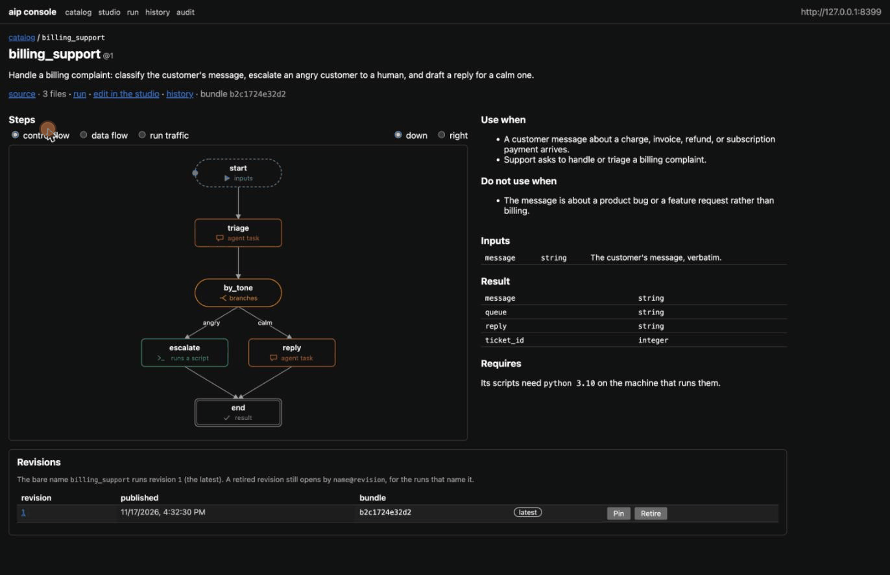
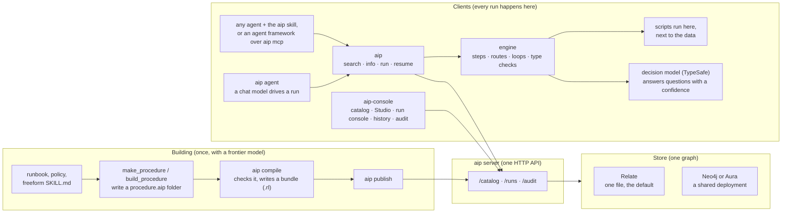

<table>
  <tr>
    <td width="200" align="center" valign="middle">
      
    </td>
    <td valign="middle">
      <h1>AIP — Agent Instruction Protocol</h1>
      <p><em>The open standard for enforceable agent know-how, making dependability and governance the default rather than something you build.</em></p>
    </td>
  </tr>
</table>

Agent Instruction Protocol (AIP) is an open standard for writing a task down as a procedure that any agent runs step by step, exactly as written, with every run recorded.

## Quick Start

**1. Install.** One command installs the `aip` command and the `aip` skill into every coding agent it finds. The server starts on its own when a command first needs it.

```bash
curl -sSfL https://raw.githubusercontent.com/zach-blumenfeld/aip/main/install.sh | bash
aip list          # the four procedures aip ships
```

**2. Build.** Ask your coding agent to write a procedure and publish it:

```
Build an AIP procedure for handling a billing complaint: decide whether the message
is about billing and whether the customer is angry; escalate angry customers to a
human, draft a reply for calm ones. Publish it as billing_support.
```

The agent writes a folder with `procedure.aip` in it, compiles it until it is clean, and publishes it to the catalog.

**3. Run.** Give the agent a task the procedure covers:

```
A customer wrote: "I was charged twice for March. Could you check?" Handle it.
```

It finds `billing_support` in the catalog, starts a run, and answers only the steps that are its own; the routing and the script are the procedure's.

Any other client does the same three things: search, run, resume.

<table>
<tr><th>CLI</th><td>

```bash
aip search "customer charged twice"
aip run billing_support -i '{"message": "I was charged twice for March."}'
aip resume <run_id> --answers '{"billing": true, "tone": "calm"}'
```

</td></tr>
<tr><th>MCP</th><td>

```json
{"mcpServers": {"aip": {"command": "aip", "args": ["mcp"]}}}
```

Any agent framework gets the tools `search`, `describe`, `run` and `resume`; with `aip mcp --publish`, one to publish ([`docs/mcp.md`](docs/mcp.md)).

</td></tr>
<tr><th>Python SDK</th><td>

```python
import aip

client = aip.Client(agent="support-app")

# Three tools for any agent, good for every procedure in the catalog.
def search(query: str) -> list[dict]:
    return [{"name": hit.name, "description": hit.description} for hit in client.search(query)]

def run(procedure: str, inputs: dict) -> dict:
    return client.run(procedure, inputs).to_json()      # done with a result, or paused with a task

def resume(run_id: str, answers: dict) -> dict:
    return client.resume(run_id, answers).to_json()
```

[`docs/sdk.md`](docs/sdk.md)

</td></tr>
</table>

**4. Audit.** Open the console to see every run, from every client, step by step:

```bash
npx aip-console --server http://127.0.0.1:8247
```



[More ways to install and deploy](#install-and-deploy) are below.

## What Is AIP?

AIP is used to distill domain knowledge into procedures that even small, inexpensive agents follow step by step, with explicit control flow and a record of every run for auditing.

As an open protocol, AIP works with any model, agent harness, or orchestration stack. It was designed for agentic AI, but an AIP client can be any application or a human operator.

Two open standards cover parts of this today. [Model Context Protocol (MCP)](https://modelcontextprotocol.io/) decouples tools, data, and other assets into a service any agent can call. [Agent Skills](https://agentskills.io/) represent procedural knowledge in a portable form that humans can read and maintain.

AIP fills the gap between them. A procedure is written in a small, readable language and adds what a freeform skill lacks: typed steps, explicit control flow, and a runtime any client can drive, the way MCP gave tools a service any agent can call. An agent reaches it through one Agent Skill (`aip`) or over MCP, and a procedure can be exported as a plain Agent Skill for an agent that has no `aip`. The result is predictability, portability, auditability, and lower cost for teams running autonomous agents.

A procedure that triages support tickets, as the AIP console draws it:\


## Contents

- [Quick Start](#quick-start)
- [Key Concepts](#key-concepts)
- [How It Works](#how-it-works)
- [Research and Evidence So Far](#research-and-evidence-so-far)
- [Project Structure](#project-structure)
- [Install and Deploy](#install-and-deploy)
- [Reference](#reference)
- [Development & Contributing](#development--contributing)

## Key Concepts

### Procedures

An AIP _procedure_ is step-by-step know-how in an executable form: a small graph of steps that guides an agent through a task, with its tools, its decisions and its branches written down.

A procedure is a folder holding `procedure.aip`, written in the AIP language ([`docs/language/spec.md`](docs/language/spec.md)), with any `scripts/`, `assets/` and `references/` beside it. The compiler checks it and turns it into a _bundle_, one `.rl` file that holds the procedure as a graph and every file it needs. A bundle is what runs, what a server publishes under a name and a revision, and what every run is recorded against.

Part of the billing-support example:

```
Decide triage "Classify whether the message is about billing and how upset the customer is." {
  Read message
  Answer_Questions {
    billing: true_or_false "Is this message about a charge, invoice, refund, or subscription payment?"
    tone:    choice [angry, calm] tone_question
  }
  Produce triage_decision
  Next_Step by_tone
}

Route On by_tone "Angry customers, and those the model is unsure of, go to a human queue; calm ones get a drafted reply." {
  Read triage_decision.tone
  Confidence_Below 0.9 -> escalate
  angry -> escalate
  calm  -> reply
}
```

### Steps and State

There are seven kinds of step, and two kinds of loop:

| kind | what it does |
|---|---|
| `Start` | holds the procedure's inputs, what the client supplies |
| `Decide` | asks a decision model typed questions about the state (yes or no, a choice, a score); each answer carries the model's confidence |
| `Route` | branches on one answer, after checking its confidence if the author asked for that |
| `Aggregate` | combines several answers into one yes or no (`All`, `Any`, `None`) |
| `Execute` | runs a script and adds its result to the state |
| `Task_Agent` | hands work to whoever is running the procedure, an agent or a person, with a prompt and the keys to produce |
| `End` | declares which keys are the procedure's result |
| `For`, `Loop` | repeat a body of steps: once per item of a list, or until an answer holds, up to a cap |

The state is the one JSON object a run carries. Each step says which keys it reads (`Read`) and which it adds (`Produce`), with their types; keys accumulate, and a later step may overwrite one.

### Procedure Distillation

Procedures can be written by hand, but the recommended workflow is to distill them from material that already exists. Most domain know-how is already written somewhere; just not in an executable form. It sits in runbooks and SOPs, policy documents, post-mortems and incident reviews, decision logs and design deliberations, existing freeform Agent Skills, wiki pages, ticket threads, etc.

AIP ships procedures that build procedures. `make_procedure` has your agent write a procedure from a description and compiles it until it is clean; `build_procedure` reads a brief and a folder of documents, settles the rules with a person, writes the folder, tries it once and reviews it against the rules; `edit_procedure` changes one as an instruction says and shows the change as a diff. The console's Studio and `aip agent` run the last two for you. Step 2 of the [Quick Start](#quick-start) does this end to end.

### Runtime Protocol

The runtime protocol is how a procedure gets executed: the step kinds, the state that flows between steps, and the pauses where a client must act.

1. **Every run is local to its client.** The `aip` command (or the Python SDK, or `aip mcp`) loads the bundle and walks the graph on your machine: it checks each step's inputs and outputs against their types, runs scripts next to your data, asks the decision model, follows routes and loops.
2. **A server keeps the catalog and the record.** `aip server` holds published procedures and every run, step by step. It never runs a step, a script or a model, and holds no model key. The installer sets up a local one that starts on demand; a team points its clients at a shared one.
3. **A run pauses only where a step is the client's.** That is a `Task_Agent` step: the pause carries a prompt, the state the step reads, and the keys to answer with. Whoever resumes the run answers it.

For an agent with no `aip` at all, `aip export <procedure> --skill DIR` writes a procedure out as a plain Agent Skill to follow by hand.

## How It Works



The agent never decides anything the procedure can decide. It starts a run, and the `aip` client walks the graph: it checks each step's input, runs the scripts, asks the decision model and follows the routes. It stops only at a step that is the agent's to do. Nothing is put to the agent to confirm: a decision's answer carries the model's confidence, and a route checks it and sends an unsure run where the author says. Every step, answer and pause is recorded against the exact bundle that ran, which is what the history and audit views read.

## Research and Evidence So Far

Our research shows AIP lifting Claude Sonnet's task pass rate from 51% to 63% over the same skills as Agent Skills.

Our paper [AIP: A Graph Representation for Learning and Governing Agent Skills](https://arxiv.org/pdf/2606.04781), published at a VLDB 2026 workshop, measured the previous format (`0.3a3`, skills as structured YAML loaded into context, before the server existed) on a stratified core of 24 [SkillsBench](https://www.skillsbench.ai) tasks. Each task's human-curated skill was converted to AIP once by Claude Opus; Claude Sonnet 4.6 then solved the task with either the original or the conversion, five trials per task.

| Skill given to the solver | Pass rate | Mean reward |
|---|---|---|
| Human-curated Agent Skill | 50.8% | 0.567 |
| The same skill converted to AIP | **63.3%** | **0.668** |

Tool-call counts were about equal, and wall clock was lower on the AIP side in two of the three task cohorts. AIP has moved on since: procedures are now written in a small language and compiled, steps are typed, a decision model answers the questions and a route checks its confidence, and every run is recorded. Measuring this release the same way is the next study, and the harness is [aip-skillbench](https://github.com/zach-blumenfeld/aip-skillbench).

## Project Structure

Everything is in this repository:

| package | where | what it holds | install |
|---|---|---|---|
| `agent-instruction-protocol` (PyPI) | `src/aip/` | the `aip` command and the Python SDK: the language's compiler (`aip compile`, `fmt`, `export`), the runtime, `aip agent`, `aip mcp`, `aip server` with its two backends, the `aip` skill ([`skills/aip/`](skills/aip/)) and the example programs ([`examples/language/`](examples/language/)) | `uv tool install agent-instruction-protocol` |
| `aip-console` (npm) | [`console/`](console/) | the web console: the catalog, each procedure as a step graph with its source, the Studio, the run console, history and audit, over a running `aip server` | `npx aip-console --server URL` |

The VS Code extension for `procedure.aip` is [`editors/vscode/`](editors/vscode/).

## Install and Deploy

The installer in the [Quick Start](#quick-start) installs [uv](https://docs.astral.sh/uv/) if missing, the `aip` command, and the `aip` skill into every agent it detects (Claude Code, Cursor, Windsurf, Copilot, Gemini CLI, Cline, Codex, Pi, OpenCode, Junie). It also sets `aip config server local`, so runs are recorded on this machine with nothing to start. Re-run it any time to upgrade. Open a new terminal afterwards if `aip` is not found.

### Try a shipped example

`aip example` lists the example programs that come with the package. `billing-support-agent` needs no model key: it hands its one decision to whoever is running.

```bash
aip example billing-support-agent        # writes ./billing-support-agent
aip info ./billing-support-agent         # what it does, the inputs it expects, how it flows
aip run ./billing-support-agent -i '{"message": "I was charged twice for March. Could you check?"}'
aip publish ./billing-support-agent      # compiles, uploads, prints billing_support_agent@1
```

The run pauses with a task and a `run_id`. Answer it with `aip resume <run_id> --answers '{...}'`, giving the keys the pause names. `aip runs` lists the runs; `aip runs <run_id>` shows one step by step.

### Build from a document

Put a runbook, SOP or policy in a folder and ask your agent:

```
Build an AIP procedure from ./refund-runbook.md
```

The skill runs `make_procedure`, which has the agent write the folder and compiles it until it is clean. Then `aip run ./<folder>` tries it as a draft and `aip publish ./<folder>` puts it in the catalog.

### Optional

- `aip config --decision-model-key KEY` with a [TypeSafe](https://typesafe.ai) key lets `Decide` steps run: a decision model answers their questions, and each answer carries a confidence a route can check. The `billing-support` example uses one.
- `aip config agent --model-key KEY` lets `aip agent "<task>"` hand a whole task to a chat model that finds, runs or builds a procedure for it ([`docs/agent.md`](docs/agent.md)).

### Other ways to install

```bash
uv tool install agent-instruction-protocol      # the `aip` command; uv fetches Python 3.14
aip skill install                               # the `aip` skill, into every detected agent
aip skill install claude-code                   # one agent; `aip skill list` shows them
aip skill install --path ./.claude/skills       # a project's skills directory
```

With pip, into an environment on Python 3.14 or later: `pip install agent-instruction-protocol`, then `aip skill install`. From a checkout: `uv tool install --force --reinstall --no-cache 'agent-instruction-protocol @ <path>'` (without `--reinstall --no-cache`, uv may install a build it cached earlier). On native Windows use the `uv tool install` line; the installer is a bash script.

### Model Recommendation for Building

Use the **largest frontier model available** when building a procedure. The work is cognitively intense and underrepresented in current training data — smaller models struggle.

For *running* the resulting procedure, the opposite holds: AIP's structure is what makes smaller, cheaper models more competitive on workflow-heavy tasks.

### Explore the data with Cypher

The catalog and every run are one graph. Out of the box it lives in a file only `aip server` can open; to look at it in Neo4j Browser, or from any Bolt driver, follow [Explore the data with Cypher](docs/deploying.md#explore-the-data-with-cypher): install the `relate` command, stop the server, and start the two again connected over Bolt. It is the same store before and after.

### Share Across Teams

`aip server` connects over Bolt to any Neo4j database. [Neo4j Aura](https://console.neo4j.io) is the easiest to host, because it is fully managed:

```bash
export NEO4J_PASSWORD=<password>
aip server --backend neo4j --uri neo4j+s://xxxxxxxx.databases.neo4j.io --user neo4j
```

[Share Across Teams](docs/deploying.md#share-across-teams) has the steps, and what running one server for everyone adds: named tokens, so the record says who made each run, and the database password in one place.

## Reference

- [`docs/running.md`](docs/running.md): running a procedure, pauses and answers, configuration.
- [`docs/demo/local.md`](docs/demo/local.md): an end-to-end walkthrough with Claude Code, Codex and the console.
- [`docs/language/spec.md`](docs/language/spec.md): the language. [`skills/aip/references/language.md`](skills/aip/references/language.md) is the same on one page.
- [`docs/agent.md`](docs/agent.md): `aip agent`. [`docs/mcp.md`](docs/mcp.md): `aip mcp`, for agent frameworks. [`docs/sdk.md`](docs/sdk.md): the Python SDK.
- [`docs/deploying.md`](docs/deploying.md): where the catalog and the runs live: on your machine, with Neo4j Browser looking in, or shared across teams.
- [`docs/server-design.md`](docs/server-design.md): the server, its API and its two backends.
- [`docs/cli-json.md`](docs/cli-json.md): every JSON object the CLI prints.
- [`console/README.md`](console/README.md): the console.

**Scripts and trust.** A procedure's `Execute` steps are scripts, and they run on the client, in the `aip` process's user account, never on the server. `aip` does not sandbox them; the script timeout (`aip config --script-timeout`, 300 seconds by default) is the only limit it applies. Running a published procedure is therefore running its author's code on your machine, the same trust as a CI runner: give the `publish` scope only to people whose code your clients would run, and pin revisions where that matters.

## Development & Contributing

```bash
uv sync --group dev        # everything, editable, with pytest
uv run pytest -q           # every test; the Neo4j half of the server's suite skips unless NEO4J_URI is set
uv tool install --editable .
```

The compiler, the runtime, the server and the client are one package (`src/aip/`). The console has its own tests (`npm test` and `npm run e2e` in `console/`), as does the VS Code extension (`editors/vscode/`). [`AGENTS.md`](AGENTS.md) has the repo map, the conventions and the release process.

### Versioning and releases

The package has one version; the language has its own (`LANGUAGE_VERSION`, `0.9`), which moves only when the language changes. `aip --version` prints both. The rules are in the [roadmap](https://github.com/zach-blumenfeld/aip/issues/20) and in [`AGENTS.md`](AGENTS.md).

### Changelog

See [`CHANGELOG.md`](CHANGELOG.md). The format follows [Keep a Changelog](https://keepachangelog.com/). Add notable changes under `[Unreleased]` as you make them; promote to a versioned section when you tag the release.
