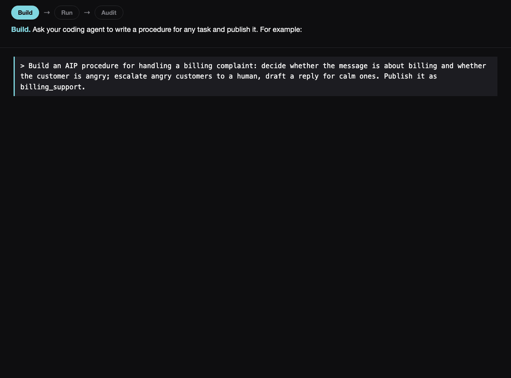
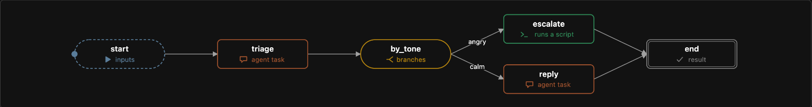
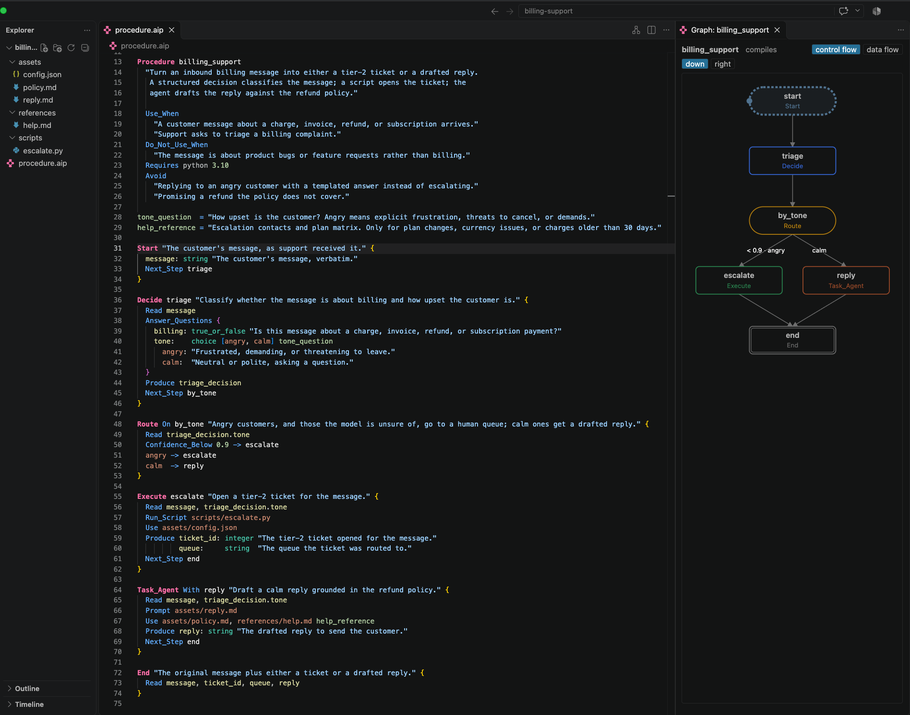
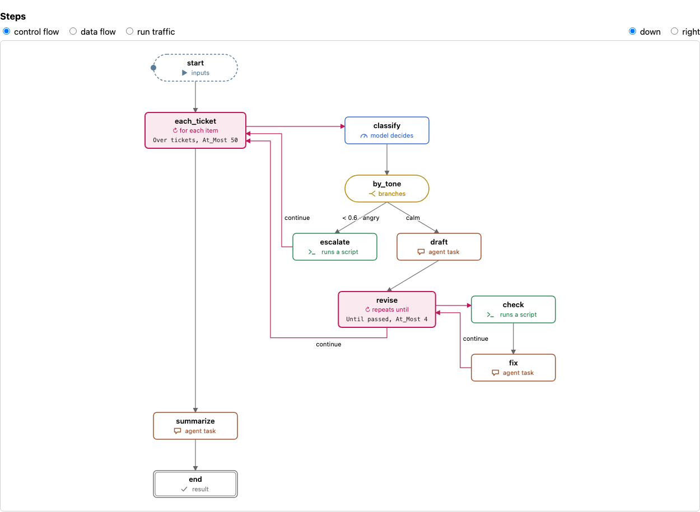
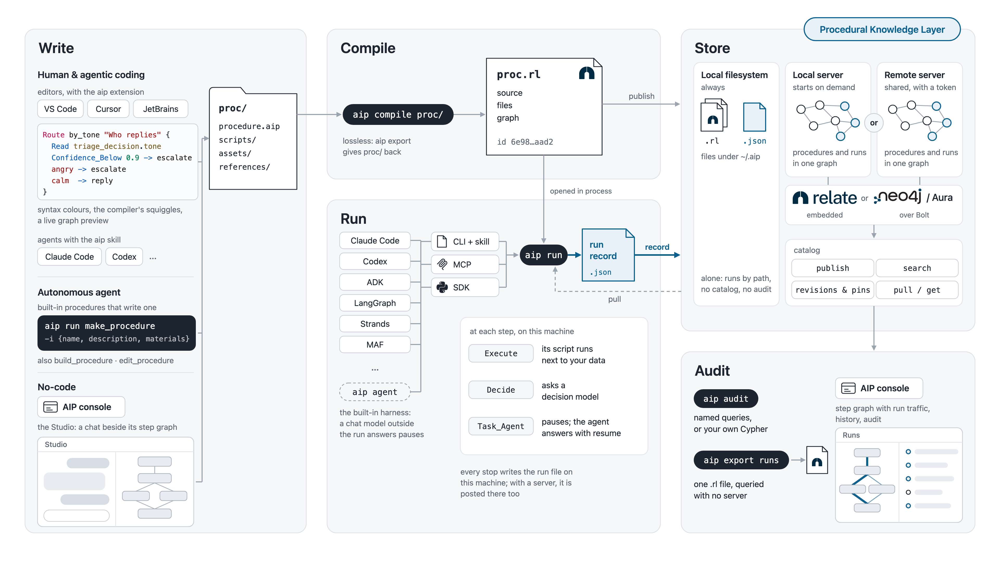

<table>
  <tr>
    <td width="200" align="center" valign="middle">
      
    </td>
    <td valign="middle">
      <h1>AIP — Agent Instruction Protocol</h1>
      <p><em>The open standard for reliable agent workflows: portable like a skill, enforced like code.</em></p>
    </td>
  </tr>
</table>

Write any task once as an AIP procedure: any agent follows the steps as written, and every run is recorded by default, regardless of your harness or orchestration framework.

## Quick Start

### Install
```bash
# Install
curl -sSfL https://raw.githubusercontent.com/zach-blumenfeld/aip/main/install.sh | bash
```
### Video


### Steps
**1. Build.** Ask your coding agent to write a procedure for any task and publish it. For example:

```
Build an AIP procedure for handling a billing complaint: decide whether the message
is about billing and whether the customer is angry; escalate angry customers to a
human, draft a reply for calm ones. Publish it as billing_support.
```

The result is a procedure: a graph of steps whose control flow AIP enforces. This one has agent tasks, a route and a script:



A procedure can also have decisions made by a decision model with a confidence (when one is configured), loops, and steps run in parallel batches.

**2. Run.** Give the agent a task the procedure covers:

```
A customer wrote: "I was charged twice for March. Could you check?" Handle it.
```

It finds `billing_support` in the AIP catalog and runs it, pausing only where a step needs the agent.

Any agent can run the same procedure, with the same enforced control flow, from the CLI, the MCP server or the Python SDK: search to find it, run, and resume. The catalog can also be served remotely, to [share procedures across teams](#share-across-teams).

<table>
<tr><th>CLI</th><td>

```bash
aip search "customer charged twice"
aip run billing_support -i '{"message": "I was charged twice for March."}'
aip resume <run_id> --answers '{"billing": true, "tone": "calm"}'
```

</td></tr>
<tr><th>MCP</th><td>

```json
{"mcpServers": {"aip": {"command": "aip", "args": ["mcp"]}}}
```

Any agent framework gets the tools `search`, `describe`, `run` and `resume`; with `aip mcp --publish`, one to publish ([`docs/mcp.md`](docs/mcp.md)).

</td></tr>
<tr><th>Python SDK</th><td>

```python
import aip

client = aip.Client(agent="support-app")

# Three tools for any agent, good for every procedure in the catalog.
def search(query: str) -> list[dict]:
    return [{"name": hit.name, "description": hit.description} for hit in client.search(query)]

def run(procedure: str, inputs: dict) -> dict:
    return client.run(procedure, inputs).to_json()      # done with a result, or paused with a task

def resume(run_id: str, answers: dict) -> dict:
    return client.resume(run_id, answers).to_json()
```

[`docs/sdk.md`](docs/sdk.md)

</td></tr>
</table>

**3. Audit.** Open the console to see every run, from every client, step by step:

```bash
npx aip-console --server http://127.0.0.1:8247
```


[More ways to install and deploy](#install-and-deploy) are below.

## Where AIP Fits

Agents need to know how you work. We express that know-how, called “procedural knowledge”, in two ways: by writing it or by coding it.

1. **Writing** instructions in skills and prompts, which are easy to read, update and standardize, and which any agent can use. However, the agent decides how to follow them, so they are not enforceable.
2. **Coding** them into a harness or orchestration framework, which makes them enforceable and deterministic. However, the steps are hard-coded into one stack, so they are not portable, and in most cases they are more complicated to understand, maintain and update.


Most teams use both together, so know-how lives in two places: part in skills, part in code. Neither copy is both portable and enforced, and it is hard to observe or evaluate what the agent actually followed. We believe this is behind most agent reliability and governance problems today.

AIP is a third form that keeps the know-how in one place. A procedure is readable, standard and portable like skills, enforced like code, and recorded on every run so it can be observed and evaluated. The model's judgment stays in the steps that need it.

| | Written | Coded | AIP |
|---|---|---|---|
| | Skills and prompts | Harnesses and orchestration frameworks | Procedures |
| **Standard and portable** | Yes: any agent can use it. | No: hard-coded into one stack. | Yes: any agent can run it. |
| **Easy to read and update** | Yes | In most cases, less so. | Yes |
| **Enforced** | No: the agent decides how to follow it. | Yes: the steps are deterministic. | Yes: the runtime runs the steps as written. |
| **Observable** | No: nothing records what the agent followed. | Where you add tracing. | Yes: every run is recorded by default. |

AIP is not a harness or a framework, and it does not replace yours. The agent you have today can use AIP - driving the run through the command line, MCP or the Python SDK.

## Contents

- [Quick Start](#quick-start)
- [Key Concepts](#key-concepts)
- [How It Works](#how-it-works)
- [Project Structure](#project-structure)
- [Install and Deploy](#install-and-deploy)
- [Research and Evidence So Far](#research-and-evidence-so-far)
- [Reference](#reference)
- [Development & Contributing](#development--contributing)

## Key Concepts

### Procedures

An AIP _procedure_ is step-by-step know-how in a declarative workflow form: a small graph of steps that guides an agent through a task, with its tools, its decisions and its branches written down.

A procedure is a folder holding `procedure.aip`, written in the AIP language ([`docs/language/spec.md`](docs/language/spec.md)), with any `scripts/`, `assets/` and `references/` beside it. The compiler checks it and turns it into a _bundle_, one `.rl` file that holds the procedure as a graph and every file it needs. A bundle is what runs, what a server publishes under a name and a revision, and what every run is recorded against.

The billing-support example ([`examples/language/billing-support`](examples/language/billing-support)), open in VS Code with the AIP extension. On the left is the folder: `procedure.aip` with its `assets/`, `references/` and `scripts/`. In the middle is the procedure: a `Start`, a `Decide` that classifies the message, a `Route` that sends angry or uncertain cases to a script and calm ones to the agent, and an `End`. On the right is the graph the compiler makes of it.



### Steps and State

There are seven kinds of step, and two kinds of loop:

| kind | what it does |
|---|---|
| `Start` | holds the procedure's inputs, what the client supplies |
| `Decide` | asks a decision model typed questions about the state (yes or no, a choice, a score); each answer carries the model's confidence |
| `Route` | branches on one answer, after checking its confidence if the author asked for that |
| `Aggregate` | combines several answers into one yes or no (`All`, `Any`, `None`) |
| `Execute` | runs a script and adds its result to the state |
| `Task_Agent` | hands work to whoever is running the procedure, an agent or a person, with a prompt and the keys to produce |
| `End` | declares which keys are the procedure's result |
| `For`, `Loop` | repeat a body of steps: once per item of a list, or until an answer holds, up to a cap |

The ticket-triage example ([`examples/language/ticket-triage`](examples/language/ticket-triage)) uses every kind but `Aggregate`, with a `For` over the tickets and a review `Loop` inside it, as the AIP console draws it:



The state is the one JSON object a run carries. Each step says which keys it reads (`Read`) and which it adds (`Produce`), with their types; keys accumulate, and a later step may overwrite one.

### Decision Models

A `Decide` step is answered by a decision model, not by the agent. A decision model, also called a System One model after the fast, intuitive kind of thinking, is a small model that answers typed questions (yes or no, a choice, a score) in one pass. It returns each answer with a confidence and a probability for each value.

A procedure can act on how sure the model was: a `Route` can check the confidence and send an unsure case elsewhere, and an `Aggregate` can set a probability bar. This lets a procedure make judgment calls quickly and cheaply, and keeps a large model's slower reasoning for the steps that need it.

AIP is currently tested with [TypeSafe](https://typesafe.ai), and more providers are being considered. Setup is one key, `aip config --decision-model-key KEY` ([`docs/running.md`](docs/running.md)). A decision model is optional: without one, a procedure has the agent decide in a `Task_Agent` step under fixed labels, and its route checks no confidence, as [`examples/language/billing-support-agent`](examples/language/billing-support-agent) does.

## How It Works

A procedure goes through five stages: it is written, compiled, run, stored and audited.

<picture>
  <source media="(prefers-color-scheme: dark)" srcset="docs/figures/aip-end-to-end-dark.png">
  
</picture>

### Write

Procedures can be written by hand, but most know-how is already written somewhere, in runbooks and SOPs, policy documents, post-mortems, existing Agent Skills, wiki pages and ticket threads, so the usual way is to have an agent distill one from that material. There are four ways in, and each ends at the same folder, checked by the same compiler:

- **An editor.** The VS Code extension ([`editors/vscode`](editors/vscode)) colours `procedure.aip`, shows the compiler's errors as you type and previews the graph. Cursor and Windsurf take the same extension.
- **A coding agent.** Any agent with the `aip` skill, which carries the language on one page: it writes, compiles and fixes until the procedure compiles.
- **A built-in procedure.** AIP ships procedures that build procedures. `make_procedure` has your agent write one from a description and compiles it until it is clean; `build_procedure` reads a brief and a folder of documents, settles the rules with a person, writes the folder, tries it once and reviews it against the rules; `edit_procedure` changes one as an instruction says and shows the change as a diff. Step 2 of the [Quick Start](#quick-start) does this end to end.
- **The console's Studio.** A chat that runs `build_procedure` and `edit_procedure` for you, with the step graph beside it.

### Compile

`aip compile` checks the folder and writes one file, the bundle. Nothing runs unchecked: running a folder compiles it first, and a bundle is verified again every time it is opened.

- **What the checker catches**, each as one error at its line: a step nothing leads to, a key some path never produces, a route that misses a value, a loop with no cap, a script or prompt that is not in the folder.
- **What the bundle holds:** the source byte for byte, every file the procedure uses, and the graph. Its id is the hash of the source and the files, so the same folder always gives the same id, and `aip export` writes the folder back.

### Run

Every run happens on the machine that starts it. The `aip` client loads the bundle and walks the graph one step at a time: it checks each step's inputs and outputs against their types, runs an `Execute` step's script next to your data, sends a `Decide` step's questions to the decision model, and follows routes and loops.

A run pauses only at a `Task_Agent` step, which is the agent's to do. The pause carries a prompt, the state the step reads and the keys to answer with; the agent answers with `aip resume`, and the answer is checked before anything moves. Nothing else is put to the agent: a decision's answer carries the model's confidence, and a route checks it and sends an unsure run where the author says.

A `For` loop is the map and reduce of a procedure: it runs its steps once per item of a list, in batches, and collects the results into one list for the steps that follow. A batch of decisions is one call to the decision model, and a batch of agent tasks is one pause.

Any agent can drive a run, with no new code: through the command line and the `aip` skill, through `aip mcp`, or through the Python SDK. `aip agent` is a built-in harness for when there is no agent yet: a chat model outside the run answers the pauses. For an agent with no `aip` at all, `aip export <procedure> --skill DIR` writes a procedure out as a plain Agent Skill to follow by hand.

### Store

Every run writes its files on the machine that ran it. Point the client at a server and procedures and runs also land in one graph: a catalog to search and a record to audit.

- **`aip server` keeps the catalog and the record.** It never runs a step, a script or a model, and holds no model key. The installer sets up a local one that starts on demand; a team points its clients at a shared one.
- **The catalog** gives each published bundle a name and a revision; agents find procedures with `aip search`, and a revision can be pinned or retired.
- **The store is one graph**, in a single [Relate](https://relatedb.ai) file by default, or in Neo4j or Aura for a shared deployment ([`docs/deploying.md`](docs/deploying.md)).

### Audit

Every step, answer and pause is recorded against the exact bundle that ran.

- **`aip audit`** runs named queries over the record, such as which routes fired their confidence check, which scripts failed and which branches no run took, or your own Cypher.
- **The console** draws the record over the step graph: how many runs took each edge, one run's path, every decision's confidence, and the history by procedure, agent and user.
- **`aip export runs`** writes the runs and the procedures they ran into one file that anyone can query with no server.

## Project Structure

Everything is in this repository:

| package | where | what it holds | install |
|---|---|---|---|
| `agent-instruction-protocol` (PyPI) | `src/aip/` | the `aip` command and the Python SDK: the language's compiler (`aip compile`, `fmt`, `export`), the runtime, `aip agent`, `aip mcp`, `aip server` with its two backends, the `aip` skill ([`skills/aip/`](skills/aip/)) and the example programs ([`examples/language/`](examples/language/)) | `uv tool install agent-instruction-protocol` |
| `aip-console` (npm) | [`console/`](console/) | the web console: the catalog, each procedure as a step graph with its source, the Studio, the run console, history and audit, over a running `aip server` | `npx aip-console --server URL` |

The VS Code extension for `procedure.aip` is [`editors/vscode/`](editors/vscode/).

## Install and Deploy

The installer in the [Quick Start](#quick-start) installs [uv](https://docs.astral.sh/uv/) if missing, the `aip` command, and the `aip` skill into every agent it detects (Claude Code, Cursor, Windsurf, Copilot, Gemini CLI, Cline, Codex, Pi, OpenCode, Junie). It also sets `aip config server local`, so runs are recorded on this machine with nothing to start. Re-run it any time to upgrade. Open a new terminal afterwards if `aip` is not found.

### Try a shipped example

`aip example` lists the example programs that come with the package. `billing-support-agent` needs no model key: it hands its one decision to whoever is running.

```bash
aip example billing-support-agent        # writes ./billing-support-agent
aip info ./billing-support-agent         # what it does, the inputs it expects, how it flows
aip run ./billing-support-agent -i '{"message": "I was charged twice for March. Could you check?"}'
aip publish ./billing-support-agent      # compiles, uploads, prints billing_support_agent@1
```

The run pauses with a task and a `run_id`. Answer it with `aip resume <run_id> --answers '{...}'`, giving the keys the pause names. `aip runs` lists the runs; `aip runs <run_id>` shows one step by step.

### Build from a document

Put a runbook, SOP or policy in a folder and ask your agent:

```
Build an AIP procedure from ./refund-runbook.md
```

The skill runs `make_procedure`, which has the agent write the folder and compiles it until it is clean. Then `aip run ./<folder>` tries it as a draft and `aip publish ./<folder>` puts it in the catalog.

### Optional

- `aip config --decision-model-key KEY` with a [TypeSafe](https://typesafe.ai) key lets `Decide` steps run: a decision model answers their questions, and each answer carries a confidence a route can check. The `billing-support` example uses one.
- `aip config agent --model-key KEY` lets `aip agent "<task>"` hand a whole task to a chat model that finds, runs or builds a procedure for it ([`docs/agent.md`](docs/agent.md)).

### Other ways to install

```bash
uv tool install agent-instruction-protocol      # the `aip` command; uv fetches Python 3.14
aip skill install                               # the `aip` skill, into every detected agent
aip skill install claude-code                   # one agent; `aip skill list` shows them
aip skill install --path ./.claude/skills       # a project's skills directory
```

With pip, into an environment on Python 3.14 or later: `pip install agent-instruction-protocol`, then `aip skill install`. From a checkout: `uv tool install --force --reinstall --no-cache 'agent-instruction-protocol @ <path>'` (without `--reinstall --no-cache`, uv may install a build it cached earlier). On native Windows use the `uv tool install` line; the installer is a bash script.

### Model Recommendation for Building

Use the **largest frontier model available** when building a procedure. The work is cognitively intense and underrepresented in current training data — smaller models struggle.

For *running* the resulting procedure, the opposite holds: AIP's structure is what makes smaller, cheaper models more competitive on workflow-heavy tasks.

### Explore the data with Cypher

The catalog and every run are one graph. Out of the box it lives in a file only `aip server` can open; to look at it in Neo4j Browser, or from any Bolt driver, follow [Explore the data with Cypher](docs/deploying.md#explore-the-data-with-cypher): install the `relate` command, stop the server, and start the two again connected over Bolt. It is the same store before and after.

### Share Across Teams

`aip server` connects over Bolt to any Neo4j database. [Neo4j Aura](https://console.neo4j.io) is the easiest to host, because it is fully managed:

```bash
export NEO4J_PASSWORD=<password>
aip server --backend neo4j --uri neo4j+s://xxxxxxxx.databases.neo4j.io --user neo4j
```

[Share Across Teams](docs/deploying.md#share-across-teams) has the steps, and what running one server for everyone adds: named tokens, so the record says who made each run, and the database password in one place.

## Research and Evidence So Far

Our research shows AIP lifting Claude Sonnet's task pass rate from 51% to 63% over the same skills as Agent Skills.

Our paper [AIP: A Graph Representation for Learning and Governing Agent Skills](https://arxiv.org/pdf/2606.04781), published at a VLDB 2026 workshop, measured the previous format (`0.3a3`, skills as structured YAML loaded into context, before the server existed) on a stratified core of 24 [SkillsBench](https://www.skillsbench.ai) tasks. Each task's human-curated skill was converted to AIP once by Claude Opus; Claude Sonnet 4.6 then solved the task with either the original or the conversion, five trials per task.

| Skill given to the solver | Pass rate | Mean reward |
|---|---|---|
| Human-curated Agent Skill | 50.8% | 0.567 |
| The same skill converted to AIP | **63.3%** | **0.668** |

Tool-call counts were about equal, and wall clock was lower on the AIP side in two of the three task cohorts. AIP has moved on since: procedures are now written in a small language and compiled, steps are typed, a decision model answers the questions and a route checks its confidence, and every run is recorded. Measuring this release the same way is the next study, and the harness is [aip-skillbench](https://github.com/zach-blumenfeld/aip-skillbench).

## Reference

- [`docs/running.md`](docs/running.md): running a procedure, pauses and answers, configuration.
- [`docs/demo/local.md`](docs/demo/local.md): an end-to-end walkthrough with Claude Code, Codex and the console.
- [`docs/language/spec.md`](docs/language/spec.md): the language. [`skills/aip/references/language.md`](skills/aip/references/language.md) is the same on one page.
- [`docs/agent.md`](docs/agent.md): `aip agent`. [`docs/mcp.md`](docs/mcp.md): `aip mcp`, for agent frameworks. [`docs/sdk.md`](docs/sdk.md): the Python SDK.
- [`docs/deploying.md`](docs/deploying.md): where the catalog and the runs live: on your machine, with Neo4j Browser looking in, or shared across teams.
- [`docs/server-design.md`](docs/server-design.md): the server, its API and its two backends.
- [`docs/cli-json.md`](docs/cli-json.md): every JSON object the CLI prints.
- [`console/README.md`](console/README.md): the console.

**Scripts and trust.** A procedure's `Execute` steps are scripts, and they run on the client, in the `aip` process's user account, never on the server. `aip` does not sandbox them; the script timeout (`aip config --script-timeout`, 300 seconds by default) is the only limit it applies. Running a published procedure is therefore running its author's code on your machine, the same trust as a CI runner: give the `publish` scope only to people whose code your clients would run, and pin revisions where that matters.

## Development & Contributing

```bash
uv sync --group dev        # everything, editable, with pytest
uv run pytest -q           # every test; the Neo4j half of the server's suite skips unless NEO4J_URI is set
uv tool install --editable .
```

The compiler, the runtime, the server and the client are one package (`src/aip/`). The console has its own tests (`npm test` and `npm run e2e` in `console/`), as does the VS Code extension (`editors/vscode/`). [`AGENTS.md`](AGENTS.md) has the repo map, the conventions and the release process.

### Versioning and releases

The package has one version; the language has its own (`LANGUAGE_VERSION`, `0.9`), which moves only when the language changes. `aip --version` prints both. The rules are in the [roadmap](https://github.com/zach-blumenfeld/aip/issues/20) and in [`AGENTS.md`](AGENTS.md).

### Changelog

See [`CHANGELOG.md`](CHANGELOG.md). The format follows [Keep a Changelog](https://keepachangelog.com/). Add notable changes under `[Unreleased]` as you make them; promote to a versioned section when you tag the release.
