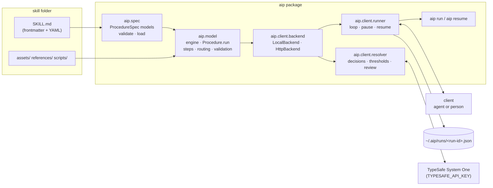

# Running a procedure

How `aip run` executes a skill, what talks to what, and what lands on disk.

## The pieces



- **`aip_spec`** (the `aip-spec` package) parses `SKILL.md` and validates the frontmatter, the YAML against the format models, and the graph; **`aip.spec.loader`** builds the runtime `Procedure` from the result.
- **`aip.model`** is the engine. `Procedure.run(after, payload, history)` is one step: check the state holds the outputs of the step the client just answered, resolve routers on it, validate it against the receiving step's `inputs`, run the step on just those keys, check its result against its declared `outputs`, merge them into the state, append a history entry, describe what comes next. At `end` the result is the state projected to the end step's `inputs`. `aip.model.engine` is the loop over it: `start(procedure, input)` and `submit(procedure, cursor, answer)` step a run until it pauses, ends, or fails, where the cursor is the run's `after`, full state, history, and pause.
- **`aip.client.backend`** is where the loop runs. `LocalBackend` runs it in-process and keeps the cursor in the run file; `HttpBackend` asks an AIP server to run it (`POST /runs`, `POST /runs/{id}/result`), and the server keeps the cursor (see [With a server](#with-a-server)). The runner is written against the two calls, so it is the same either way.
- **`aip.client.resolver`** answers decisions for the client. The loop stops at every decision; with a TypeSafe key on this machine (`TYPESAFE_API_KEY`, else `aip config --decision-model KEY`) the resolver asks the model, applies the author's thresholds that came with the step, and either hands the answers back with their attribution or turns the stop into a `review` pause. Without a key the decision pause goes to the agent. Neither the engine nor the server ever calls a model.
- **`aip.client.runner`** is the client. It opens the run, answers its pauses (from the answer file, or the terminal with `--interactive`), writes the run file, and prints one JSON object for how it stopped ([`docs/cli-json.md`](cli-json.md)).

## The loop

`Procedure.run` takes the step the client just completed (`after`, `null` to start), the run's full state, and the history, and returns the step that ran, its result, the state with its outputs merged in (`suggested`, internal), what comes next, and the history with this step's `{step, kind, input, result}` entry. The engine loops over it:

```
cursor = {after: null, state: start input, history: [], pause: null}
loop:
    node = what receives the state after `after`   (routers resolved on the state)
    if node is a decision:
        STOP decision                              -> the client resolves it (below)
    if node is an execution step:
        STOP execute                               -> the client runs the script and reports
    response = Procedure.run(after, state, history)   (a failure: ERROR, below)
    if response.next is null:                      DONE, the end step's state
    if response.kind == client_task:               PAUSE client_task -> client does the task
    after, state, history = response.ran, response.suggested, response.history
```

At a decision the client resolves (`aip.client.resolver`):

```
if a decision model is configured on this client:
    answers = model(questions, state)              (history too, if the step asks)
    if every answer clears its threshold:          submit answers, attribution {typesafe, reviewed: false}
    else:                                          PAUSE review      -> agent confirms or overrides
                                                   submit answers, attribution {typesafe, reviewed: true, proposed}
else:                                              PAUSE decision    -> agent answers the questions
                                                   submit answers, attribution {manual}
```

A pause is stored on the cursor (a review only in the client's run file: the loop still waits at the decision); an answer is merged over the cursor's state and the loop re-enters at `after`. Thresholds are the author's, from SKILL.md, and nothing else.

Every stop prints one JSON object and, unless it is an error before any step ran, writes the run file: the shapes, field by field, are in [`docs/cli-json.md`](cli-json.md). A pause carries only the paused step's declared inputs as `state`. `aip resume <run-id> --input answer.json` sends the answer to the run, which merges it over the state it holds and re-enters the loop at `after`. With `--interactive`, a pause becomes terminal prompts instead. `--progress` adds one JSON line per completed step before the final object; `--debug` puts the traceback of a failure on stderr.

| exit code | printed                                                        |
|-----------|----------------------------------------------------------------|
| 0         | `{"paused": ...}`: the client must answer                      |
| 0         | `{"done": true, ...}`: the end step's state                    |
| 1         | `{"error": <kind>, ...}`: `script_failed`, `timeout`, `invalid_input`, `invalid_output`, `requires_unmet`, or `server` |

A step that fails while running (a script exits non-zero, times out, or returns keys it did not declare) leaves the run file at the state before it; `aip resume <run-id>` with no input retries it. So does `requires_unmet`: before the first script runs, the machine that runs it is checked against the skill's `requires` block, and every missing interpreter version, package, or tool is named at once. An answer that does not fit its pause leaves the pause in place, to be answered again.

### Pause kinds

| `paused`      | when                                               | what the client posts on resume                                   |
|---------------|----------------------------------------------------|-------------------------------------------------------------------|
| `decision`    | a decision is next and this client has no decision model | one collapsed answer per question: `true`/`false`, a label, or a level |
| `review`      | this client's model answered a question below its threshold | only the questions to override among `proposed_answers`; `{}` accepts |
| `client_task` | the step handed work to the client                 | the keys in `answer_with` (the step's declared `outputs`), with their types |

With a key set, decisions run against the model and only low-confidence answers pause. Without one, the agent answers every decision itself. Either way the decision's history entry records its `attribution`: `{"resolver": "typesafe"|"manual", "model", "confidence": {question: float}|null, "reviewed"}`, plus `proposed`, the model's answers, when a review was answered.

## Files

`aip run` writes exactly one file: the run file, at `~/.aip/runs/<run-id>.json` unless `--run-file` names a path (`AIP_HOME` moves `~/.aip`). Every outcome prints the `run_id`, and `aip resume <run-id>` finds the file from any directory; `aip resume <path>` works too. A local run's id is generated when it starts; a served run's is the server's, assigned when the run opens. It is written at every pause, at an error once a step has run, and at done. A local run's file holds everything needed to continue, and at done its `history` is the run's whole ledger:

```json
{
  "skill_dir": "/home/you/work/billing-support",
  "after": null,
  "state": { "message": "I was charged twice!" },
  "history": [],
  "pause": {
    "kind": "decision",
    "step": "triage",
    "questions": { "billing": { "type": "noul", "instructions": "..." },
                   "tone":    { "type": "choice", "instructions": "...", "criteria": { "angry": "...", "calm": "..." } } },
    "state": { "message": "I was charged twice!" },
    "thresholds": { "billing": 0.15, "tone": 0.6 }
  },
  "run_id": "4f1c9a2e7b3d5068",
  "workdir": "/home/you/work",
  "created": 1790293854.39
}
```

`skill_dir` is absolute, so the run resumes from anywhere. `workdir` is the run's working directory (the directory `aip run` started in, or `--workdir`): scripts get it as `AIP_WORKDIR` and read and write the run's files there, whichever directory `resume` is called from. `state` is the run's full state; the pause's `state` is the slice the paused step declared. A decision pause also keeps the author's `thresholds` (not printed). `pause.kind` is also `error` (with the failing `step`, retried by a bare `resume`) or `done` (with the result as `state`).

A served run's file is only a handle, since the server holds the state and the history:

```json
{
  "pause": { "kind": "client_task", "step": "reply", "task": "...", "state": { "message": "...", "tone": "calm" },
             "references": [ ... ], "answer_with": { "reply": "string" } },
  "run_id": "4f1c9a2e7b3d5068",
  "server": "http://localhost:8000",
  "name": "billing-support",
  "revision": "3f9c2a7d1e5b8c04",
  "version": 3,
  "workdir": "/home/you/work",
  "created": 1790293854.39
}
```

`aip resume` rebuilds the right backend from it and posts only the answer, with the pause's `step` and the run's `version` so a run that moved on since is refused rather than answered twice.

Nothing else is written by the runner: the skill folder is read-only to it, state lives in the run file (locally) or on the server, and scripts write only what they choose to, under `AIP_WORKDIR` by convention. A served run also keeps the revision's `scripts/` and `assets/` in `~/.aip/cache/<name>@<revision>/` (below).

## Worked example: `billing-support`

The example skill ships with the `aip-spec` package; `aip-spec example billing-support --out .` writes it to `./billing-support`, which the commands below run.

The graph: `triage` (decision: is it billing, what is the tone) → `by-tone` (router) → `escalate` (script opens a ticket) or `reply` (client drafts a reply against the policy) → `end`.

### Without a decision model

```bash
$ echo '{"message": "I was charged twice!"}' > start.json
$ aip run billing-support --input start.json --run-file run.json
{
  "paused": "decision",
  "step": "triage",
  "questions": {
    "billing": { "type": "noul",
                 "instructions": "Is this message about a charge, invoice, refund, or subscription payment?" },
    "tone":    { "type": "choice",
                 "instructions": "How upset is the customer? Angry means explicit frustration, threats to cancel, or demands.",
                 "criteria": { "angry": "Frustrated, demanding, or threatening to leave.",
                               "calm": "Neutral or polite, asking a question." } }
  },
  "state": { "message": "I was charged twice!" },
  "run_id": null,
  "run_file": "run.json"
}
$ echo $?
0
```

The client answers and resumes. The router sends `angry` to the script, which runs for real:

```bash
$ echo '{"billing": true, "tone": "angry"}' > answers.json
$ aip resume run.json --input answers.json --progress
{"event": "step", "step": "triage", "kind": "decision", "resolver": "manual"}
{"event": "step", "step": "by-tone", "kind": "router", "to": "escalate"}
{"event": "step", "step": "escalate", "kind": "execution", "seconds": 0.031}
{"done": true, "run_id": null, "state": {"message": "I was charged twice!"}, "run_file": "run.json"}
```

The ticket is in the run file's `history`, the run's ledger:

```json
[
  { "step": "triage",   "kind": "decision",  "input": { "message": "..." },
    "result": { "answers": { "billing": true, "tone": "angry" } },
    "attribution": { "resolver": "manual", "model": null, "confidence": null, "reviewed": false } },
  { "step": "by-tone",  "kind": "router",    "input": { "tone": "angry" }, "result": { "to": "escalate" } },
  { "step": "escalate", "kind": "execution", "input": { "message": "...", "tone": "angry" },
    "result": { "ticket_id": 45067, "queue": "tier2" }, "seconds": 0.031 },
  { "step": "end",      "kind": "end",       "input": { "message": "..." }, "result": { "message": "..." } }
]
```

### With a decision model

Same start, with a key on this machine (`TYPESAFE_API_KEY`, or `aip config --decision-model KEY`). The model answers `billing` at 0.97 and `tone` as `angry` at 0.55 confidence, under the step's threshold of 0.6, so the run pauses for review instead of routing:

```json
{
  "paused": "review",
  "step": "triage",
  "state": { "message": "I was charged twice!" },
  "proposed_answers": { "billing": true, "tone": "angry" },
  "review": [
    { "question": "tone", "type": "choice", "confidence": 0.55,
      "probabilities": { "angry": 0.55, "calm": 0.45 }, "reason": "confidence below 0.6" }
  ],
  "run_id": null,
  "run_file": "run.json"
}
```

Nothing is recorded yet. The client reads the message, disagrees with the model, and overrides; the decision is recorded with `"resolver": "typesafe"`, `"reviewed": true`, and the model's `proposed` answers. The router now sends `calm` to the client task, which pauses again with the template rendered from the step's inputs, the policy injected from `assets/policy.md`, and the reference the client may load on demand:

```bash
$ echo '{"tone": "calm"}' > override.json
$ aip resume run.json --input override.json
{
  "paused": "client_task",
  "step": "reply",
  "task": "# Draft a reply\n\nWrite a short, calm reply to the customer below. Apply the policy exactly...\n\nCustomer message:\nI was charged twice!\n\nPolicy:\n# Refund policy\n\n- Duplicate charges are refunded in full within 5 business days.\n...",
  "state": { "message": "I was charged twice!", "tone": "calm" },
  "references": [
    { "uri": "billing-support/references/help.md",
      "description": "Escalation contacts and plan matrix. Only for plan changes, currency issues, or charges older than 30 days." }
  ],
  "answer_with": { "reply": "string" },
  "run_id": null,
  "run_file": "run.json"
}
```

The client does the task and answers with the step's declared outputs. `end` declares only `message`, so that is the run's result; the reply is recorded in the history:

```bash
$ echo '{"reply": "Sorry about the duplicate charge. A full refund is on its way within 5 business days."}' > reply.json
$ aip resume run.json --input reply.json
{
  "done": true,
  "run_id": null,
  "state": { "message": "I was charged twice!" },
  "run_file": "run.json"
}
```

### When a script fails

If `escalate.py` exits 1 with `ticket service unreachable` on stderr, the angry branch stops at it:

```json
{
  "error": "script_failed",
  "step": "escalate",
  "message": "Script scripts/escalate.py exited with 1:\nticket service unreachable",
  "script": "scripts/escalate.py",
  "exit_code": 1,
  "stderr": "ticket service unreachable",
  "run_id": null,
  "resumable": true,
  "run_file": "run.json"
}
```

The run file now holds the state before `escalate` (the message and both answers). Once the cause is fixed, `aip resume run.json` with no input runs `escalate` again and continues.

### Interactive

```bash
$ aip run billing-support --interactive
message (string): I was charged twice!

tone: confidence below 0.6  (model says "angry")
  {"angry": 0.55, "calm": 0.45}
  keep "angry"? enter to keep, or a new value: calm

# Draft a reply
...
reply (string): Sorry about the duplicate charge. A full refund is on its way within 5 business days.
{ "done": true, ... }
```

Same loop, same engine; prompts replace the pauses.

## With a server

The same loop runs on the server, which holds the run. `aip server` runs the engine for every published skill (`docs/server-design.md`), and keeps each run's state and history in its run backend. It never runs a script and holds no decision-model key: execution steps run on the client, next to its data, and the client resolves decisions with its own key (`docs/client-execution.md`). The client points at it once:

```
$ export AIP_SERVER=http://localhost:8000            # or: aip config --server http://localhost:8000 [--token T]
$ aip-spec example billing-support --out .            # the bundled example, as a folder
$ aip publish billing-support                        # validate locally, upload, server validates again
billing-support@3f9c2a7d1e5b8c04
$ aip search "refund"                                # ranked by the server
billing-support@3f9c2a7d1e5b8c04  0.812  Triage an inbound billing message ...
$ aip info billing-support --example-input > start.json
$ aip run billing-support --input start.json         # same pause; `run_id` is the server's
```

`aip run <name>` uses `HttpBackend`, which makes two calls:

| call | body | reply |
|---|---|---|
| `POST /runs` | `{"name", "revision"?, "input"}` | 201: where the run stopped |
| `POST /runs/{id}/result` | `{"answer"?, "attribution"?, "step"?, "version"?}`; no `answer` (or no body) retries a failed step | 200: where the run stopped |

At an execution step the run stops and the reply is the step to perform, which the CLI never prints:

```json
{ "paused": "execute", "step": "escalate", "script": "scripts/escalate.py", "command": null,
  "stdin": { "state": { "message": "...", "tone": "angry" }, "assets": { "config": "..." }, "expects": { ... } },
  "timeout": 60.0, "requires": { "interpreter": "python", "version": "3.10", "packages": [], "tools": [] },
  "run_id": "4f1c9a2e7b3d5068", "name": "billing-support", "revision": "3f9c2a7d1e5b8c04", "version": 2, "steps": [ ... ] }
```

`HttpBackend` fetches the revision's `scripts/` and `assets/` (never `SKILL.md`) into `~/.aip/cache/<name>@<revision>/`, each file checked against the sha256 in the server's manifest (`GET /catalog/<ref>/files`) and the cache re-verified before each run; checks `requires` against this machine; runs the script from its folder in the cache with `stdin` on stdin and the run's `workdir` as `AIP_WORKDIR`; and posts the report as the `answer`: `{"output": {...}, "seconds": 0.04}`, or a failure, `{"error": "script_failed", "exit_code": 2, "stderr": "..."}`, `{"error": "timeout", "seconds": 60}`, or `{"error": "requires_unmet", "missing": [...]}`, each with `host`, the client machine's name. The server checks the output against the step's declared outputs and records it, or records the failure, with the `host` on the history entry, so `failing-scripts` still sees every client's exit code and stderr. If the scripts cannot be fetched, the run waits at the step and `aip resume` tries again.

At a decision the reply is the decision pause with the author's `thresholds` (and the run's `history` when the step sets `history: true`); `HttpBackend` resolves it as above and posts the answers with their `attribution`, or keeps a review in the run file until the agent answers it. With no `attribution` the answer is recorded as manual. The server checks the answers against the question types and the attribution's shape (a 422 `invalid_output` naming `attribution` when it does not fit) and records both.

Where the run stopped is the CLI's paused, done or error object (a decision pause also carries the author's `thresholds`) plus `run_id`, `name`, `revision`, the run's `version`, and `steps`, the `--progress` line of each step the call completed; an error carries `resumable: true`. A step that fails is a 200 with the error object: the run recorded it, with status `failed` and the state before the step. A start input or an answer that does not fit is a 422 in the error envelope and changes nothing (no run is opened; the pause stands). A post whose `step` or `version` is not the run's current one, or that lost a race with another post, is a 409 `stale_run`. Each call loads the run from the backend, steps it, and stores what changed with a version check, so nothing per run is held in the server process and any replica over the same backend can answer any call.

The server resolves the name to one revision when the run opens, and the run stays on it. `GET /runs/<run_id>` shows the run's `state`, `history`, `status`, `pause` and `version`: for the same inputs, the same state and history a local run writes to its run file. `/procedures/<name>/peek|step|answer`, where the client carried the state and history itself, still answer for one version, with a `Deprecation` header; `step` refuses an execution step (409 `runs_on_client`) and a decision (422 `no_decision_model`; `answer` takes the answers and an optional `attribution`). A folder path (`aip run ./billing-support`) still runs locally and never touches the server; `aip get <name>` downloads a published revision losslessly when you want the folder.

Decision thresholds are the author's, from SKILL.md: there is no per-name override and no run flag, so a run's behaviour is fixed by its revision. Over its run history the server answers five governance questions, `GET /governance/<query>` with `name`, `window` (the last N runs), and `limit`: `overridden-decisions` (per question and resolver, model answers the agent changed at review), `manual-decisions` (per decision step, how many were answered with no model), `failing-scripts` (execution steps that raised, with the latest error and the `exit_code` and `stderr` its client reported), `missing-fields` (resolved revisions without `do_not_use_when` or `anti_patterns`), and `untaken-branches` (router branches no run followed; Neo4j only, 501 on the filesystem backend). `GET /governance` lists them.

An agent that has never seen a procedure needs one page to do all of this: the `aip-runtime` Agent Skill (`skills/aip-runtime/SKILL.md`, shipped in the package; `aip runtime --skill --out <skills dir>` writes it). It says to search first, read `info`, run, and answer the pauses, and not to do the steps by hand. [`docs/examples/aip-runtime-session.md`](examples/aip-runtime-session.md) is a transcript of a fresh agent completing `billing-support` with only that skill and `AIP_SERVER` set.
