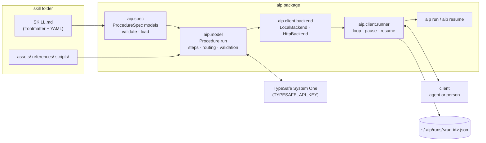

# Running a procedure

How `aip run` executes a skill, what talks to what, and what lands on disk.

## The pieces



- **`aip_spec`** (the `aip-spec` package) parses `SKILL.md` and validates the frontmatter, the YAML against the format models, and the graph; **`aip.spec.loader`** builds the runtime `Procedure` from the result.
- **`aip.model`** is the engine. `Procedure.run(after, payload, history, thresholds)` is the whole server operation: check the state holds the outputs of the step the client just answered, resolve routers on it, validate it against the receiving step's `inputs`, run the step on just those keys, check its result against its declared `outputs`, merge them into the state, append a history entry, describe what comes next. At `end` the result is the state projected to the end step's `inputs`.
- **`aip.client.backend`** is the seam between runner and engine. `LocalBackend` calls `Procedure.run` in-process; `HttpBackend` posts the same arguments to an AIP server (see [With a server](#with-a-server)). The runner is written against the interface, so it is the same loop either way.
- **`aip.client.runner`** is the client. It carries the engine's state from step to step, stops when the client must act or a step fails, and prints one JSON object for how it stopped ([`docs/cli-json.md`](cli-json.md)).

## The step protocol

Every call, local or over HTTP, has the same shape.

Request:

| field        | meaning                                                                 |
|--------------|-------------------------------------------------------------------------|
| `after`      | the step the client just completed; `null` to start                      |
| `payload`    | the client's input for whatever comes next                              |
| `history`    | everything so far; the server appends, the client carries it            |
| `thresholds` | optional per-question overrides for this call                           |

Response:

| field       | meaning                                                                                      |
|-------------|----------------------------------------------------------------------------------------------|
| `ran`       | the step that ran (routers are walked on the way and recorded in history, never "ran")      |
| `kind`      | `decision`, `execution`, `client_task`, or `end`                                             |
| `result`    | the step's raw output                                                                        |
| `suggested` | the server's proposed input for the next step; the client may post it as-is or override it   |
| `review`    | decision answers under their threshold, with the distribution; empty means safe to pass through |
| `next`      | what receives the next input: a step with its `inputs`, or a router expanded into branches   |
| `history`   | the carried-in history plus this step's `{step, kind, input, result}` entry                  |

The server is stateless. State lives in the request and response, and the client carries it (B1 moves it to the server). `suggested` is internal to this protocol: the client keeps it in the run file as `state` and never prints it.

## The runner loop

```
payload = start input
after   = null
loop:
    node = what receives payload after `after`   (routers resolved on payload)
    if node is a decision and no decision model is available:
        PAUSE decision                             -> client answers the questions
    response = run(after, payload, history, thresholds)    (a failure: ERROR, below)
    if response.next is null:                      DONE, print the end step's state
    if response.kind == client_task:               PAUSE client_task -> client does the task
    if response.review is non-empty:               PAUSE review      -> client confirms or overrides
    after, payload, history = response.ran, response.suggested, response.history
```

Every stop prints one JSON object and, unless it is an error before any step ran, writes the run file: the shapes, field by field, are in [`docs/cli-json.md`](cli-json.md). A pause carries only the paused step's declared inputs as `state`. `aip resume <run-id> --input answer.json` merges the answer over the state the run file holds and re-enters the loop at `after`. With `--interactive`, a pause becomes terminal prompts instead. `--progress` adds one JSON line per completed step before the final object; `--debug` puts the traceback of a failure on stderr.

| exit code | printed                                                        |
|-----------|----------------------------------------------------------------|
| 0         | `{"paused": ...}`: the client must answer                      |
| 0         | `{"done": true, ...}`: the end step's state                    |
| 1         | `{"error": <kind>, ...}`: `script_failed`, `timeout`, `invalid_input`, `invalid_output`, `requires_unmet`, or `server` |

A step that fails while running (a script exits non-zero, times out, or returns keys it did not declare) leaves the run file at the state before it; `aip resume <run-id>` with no input retries it. An answer that does not fit its pause leaves the pause in place, to be answered again.

### Pause kinds

| `paused`      | when                                               | what the client posts on resume                                   |
|---------------|----------------------------------------------------|-------------------------------------------------------------------|
| `decision`    | `TYPESAFE_API_KEY` is unset and a decision is next | one collapsed answer per question: `true`/`false`, a label, or a level |
| `review`      | a decision answered below its threshold            | only the questions to override among `proposed_answers`; `{}` accepts |
| `client_task` | the step handed work to the client                 | the keys in `answer_with` (the step's declared `outputs`), with their types |

With a key set, decisions run against the model and only low-confidence answers pause. Without one, the client answers every decision itself, and history records those entries with `"manual": true`.

## Files

`aip run` writes exactly one file: the run file, at `~/.aip/runs/<run-id>.json` unless `--run-file` names a path (`AIP_HOME` moves `~/.aip`). Every outcome prints the `run_id`, and `aip resume <run-id>` finds the file from any directory; `aip resume <path>` works too. A local run's id is generated when it starts; a served run's is the server's, and a served run paused before its first step (so before the server has a run) is keyed by a local id until the server assigns one, when the file moves to the server's id. It is written at every pause, at an error once a step has run, and at done, when its `history` is the run's whole ledger. It holds everything needed to continue:

```json
{
  "skill_dir": "/home/you/work/billing-support",
  "after": null,
  "state": { "message": "I was charged twice!" },
  "history": [],
  "pause": {
    "kind": "decision",
    "step": "triage",
    "questions": { "billing": { "type": "noul", "instructions": "..." },
                   "tone":    { "type": "choice", "instructions": "...", "criteria": { "angry": "...", "calm": "..." } } },
    "state": { "message": "I was charged twice!" }
  },
  "thresholds": {},
  "created": 1790293854.39,
  "server": null,
  "name": null,
  "revision": null,
  "run_id": "4f1c9a2e7b3d5068"
}
```

`skill_dir` is absolute, so the run resumes from anywhere. `state` is the run's full state; the pause's `state` is the slice the paused step declared. `pause.kind` is also `error` (with the failing `step`, retried by a bare `resume`) or `done`.

The last four are set when the run is on a server (below): the URL, the exact `name` and `revision` the run is pinned to, and the server's `run_id` once a step has run (a local run's `run_id` is its generated id). `aip resume` rebuilds the right backend from them, so a run file is self-contained either way.

Nothing else is written: the skill folder is read-only to the runner, state travels in memory and in the run file, and scripts write only what they choose to.

## Worked example: `billing-support`

The example skill ships with the `aip-spec` package; `aip-spec example billing-support --out .` writes it to `./billing-support`, which the commands below run.

The graph: `triage` (decision: is it billing, what is the tone) → `by-tone` (router) → `escalate` (script opens a ticket) or `reply` (client drafts a reply against the policy) → `end`.

### Without a decision model

```bash
$ echo '{"message": "I was charged twice!"}' > start.json
$ aip run billing-support --input start.json --run-file run.json
{
  "paused": "decision",
  "step": "triage",
  "questions": {
    "billing": { "type": "noul",
                 "instructions": "Is this message about a charge, invoice, refund, or subscription payment?" },
    "tone":    { "type": "choice",
                 "instructions": "How upset is the customer? Angry means explicit frustration, threats to cancel, or demands.",
                 "criteria": { "angry": "Frustrated, demanding, or threatening to leave.",
                               "calm": "Neutral or polite, asking a question." } }
  },
  "state": { "message": "I was charged twice!" },
  "run_id": null,
  "run_file": "run.json"
}
$ echo $?
0
```

The client answers and resumes. The router sends `angry` to the script, which runs for real:

```bash
$ echo '{"billing": true, "tone": "angry"}' > answers.json
$ aip resume run.json --input answers.json --progress
{"event": "step", "step": "triage", "kind": "decision", "resolver": "manual"}
{"event": "step", "step": "by-tone", "kind": "router", "to": "escalate"}
{"event": "step", "step": "escalate", "kind": "execution", "seconds": 0.031}
{"done": true, "run_id": null, "state": {"message": "I was charged twice!"}, "run_file": "run.json"}
```

The ticket is in the run file's `history`, the run's ledger:

```json
[
  { "step": "triage",   "kind": "decision",  "input": { "message": "..." },
    "result": { "answers": { "billing": { "type": "noul", "manual": true },
                             "tone":    { "type": "choice", "manual": "angry" } } },
    "manual": true },
  { "step": "by-tone",  "kind": "router",    "input": { "tone": "angry" }, "result": { "to": "escalate" } },
  { "step": "escalate", "kind": "execution", "input": { "message": "...", "tone": "angry" },
    "result": { "ticket_id": 45067, "queue": "tier2" }, "seconds": 0.031 },
  { "step": "end",      "kind": "end",       "input": { "message": "..." }, "result": { "message": "..." } }
]
```

### With a decision model

Same start, `TYPESAFE_API_KEY` set. The model answers `billing` at 0.97 and `tone` as `angry` at 0.55 confidence, under the step's threshold of 0.6, so the run pauses for review instead of routing:

```json
{
  "paused": "review",
  "step": "triage",
  "state": { "message": "I was charged twice!" },
  "proposed_answers": { "billing": true, "tone": "angry" },
  "review": [
    { "question": "tone", "type": "choice", "confidence": 0.55,
      "probabilities": { "angry": 0.55, "calm": 0.45 }, "reason": "confidence below 0.6" }
  ],
  "run_id": null,
  "run_file": "run.json"
}
```

The client reads the message, disagrees with the model, and overrides. The router now sends `calm` to the client task, which pauses again with the template rendered from the step's inputs, the policy injected from `assets/policy.md`, and the reference the client may load on demand:

```bash
$ echo '{"tone": "calm"}' > override.json
$ aip resume run.json --input override.json
{
  "paused": "client_task",
  "step": "reply",
  "task": "# Draft a reply\n\nWrite a short, calm reply to the customer below. Apply the policy exactly...\n\nCustomer message:\nI was charged twice!\n\nPolicy:\n# Refund policy\n\n- Duplicate charges are refunded in full within 5 business days.\n...",
  "state": { "message": "I was charged twice!", "tone": "calm" },
  "references": [
    { "uri": "billing-support/references/help.md",
      "description": "Escalation contacts and plan matrix. Only for plan changes, currency issues, or charges older than 30 days." }
  ],
  "answer_with": { "reply": "string" },
  "run_id": null,
  "run_file": "run.json"
}
```

The client does the task and answers with the step's declared outputs. `end` declares only `message`, so that is the run's result; the reply is recorded in the history:

```bash
$ echo '{"reply": "Sorry about the duplicate charge. A full refund is on its way within 5 business days."}' > reply.json
$ aip resume run.json --input reply.json
{
  "done": true,
  "run_id": null,
  "state": { "message": "I was charged twice!" },
  "run_file": "run.json"
}
```

### When a script fails

If `escalate.py` exits 1 with `ticket service unreachable` on stderr, the angry branch stops at it:

```json
{
  "error": "script_failed",
  "step": "escalate",
  "message": "Script scripts/escalate.py exited with 1:\nticket service unreachable",
  "script": "scripts/escalate.py",
  "exit_code": 1,
  "stderr": "ticket service unreachable",
  "run_id": null,
  "resumable": true,
  "run_file": "run.json"
}
```

The run file now holds the state before `escalate` (the message and both answers). Once the cause is fixed, `aip resume run.json` with no input runs `escalate` again and continues.

### Interactive

```bash
$ aip run billing-support --interactive
message (string): I was charged twice!

tone: confidence below 0.6  (model says "angry")
  {"angry": 0.55, "calm": 0.45}
  keep "angry"? enter to keep, or a new value: calm

# Draft a reply
...
reply (string): Sorry about the duplicate charge. A full refund is on its way within 5 business days.
{ "done": true, ... }
```

Same loop, same engine; prompts replace the pauses.

## With a server

Nothing changes in the protocol. `aip server` exposes `Procedure.run` over HTTP for every published skill (`docs/server-design.md`), executes scripts with its own interpreter, holds the decision-model key, and records each run. The client points at it once:

```
$ export AIP_SERVER=http://localhost:8000            # or: aip config --server http://localhost:8000 [--token T]
$ aip-spec example billing-support --out .            # the bundled example, as a folder
$ aip publish billing-support                        # validate locally, upload, server validates again
billing-support@3f9c2a7d1e5b8c04
$ aip search "refund"                                # ranked by the server
billing-support@3f9c2a7d1e5b8c04  0.812  Triage an inbound billing message ...
$ aip info billing-support --example-input > start.json
$ aip run billing-support --input start.json         # same pause; `run_id` is the server's
```

`aip run <name>` uses `HttpBackend`, which posts the same `after`, `payload`, `history`, and `thresholds` to `/procedures/<name>@<revision>/step` (and `/answer` for a manual decision) that `LocalBackend` passes to `Procedure.run`. The first call pins the name to one revision for the whole run. Pauses, errors and done are the same objects with the server's `run_id`; the run file additionally carries `server`, `name`, `revision`, and `run_id`, and `GET /runs/<run_id>` on the server shows the same history the run file holds. A script failure on the server comes back as the same `script_failed` object, and the server records it on the run. A folder path (`aip run ./billing-support`) still runs locally and never touches the server; `aip get <name>` downloads a published revision losslessly when you want the folder.

The server also keeps per-question threshold overrides per name (`GET|POST /catalog/<name>/thresholds`, body `{"thresholds": {"tone": 0.5}}`); a `step` merges them over the author's defaults and under the request's own `thresholds`, so a run's `--threshold` still wins for that call. Over its run history it answers four governance questions, `GET /governance/<query>` with `name`, `window` (the last N runs), and `limit`: `overridden-decisions` (model answers the client changed before continuing), `failing-scripts` (execution steps that raised, with the latest error), `missing-fields` (resolved revisions without `do_not_use_when` or `anti_patterns`), and `untaken-branches` (router branches no run followed; Neo4j only, 501 on the filesystem backend). `GET /governance` lists them.

An agent that has never seen a procedure needs one page to do all of this: the `aip-runtime` Agent Skill (`skills/aip-runtime/SKILL.md`, shipped in the package; `aip runtime --skill --out <skills dir>` writes it). It says to search first, read `info`, run, and answer the pauses, and not to do the steps by hand. [`docs/examples/aip-runtime-session.md`](examples/aip-runtime-session.md) is a transcript of a fresh agent completing `billing-support` with only that skill and `AIP_SERVER` set.
