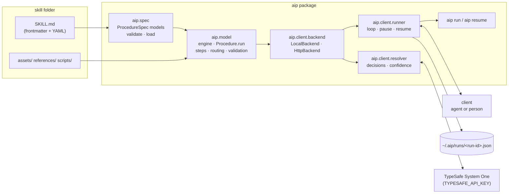

# Running a procedure

How `aip run` executes a skill, what talks to what, and what lands on disk.

## The pieces



- **`aip_spec`** (the `aip-spec` package) parses `SKILL.md` and validates the frontmatter, the YAML against the format models, and the graph; **`aip.spec.loader`** builds the runtime `Procedure` from the result.
- **`aip.model`** is the engine. `Procedure.run(after, payload, history)` is one step: check the state holds the outputs of the step the client just answered, resolve routers on it (a router with a `confidence` check reads that key first), validate it against the receiving step's `inputs`, run the step on just those keys, check its result against its declared `outputs`, merge them into the state, append a history entry, describe what comes next. The first call (`after` null) runs the `start` step: it checks the start input against the step's declared `inputs`, writes the first history entry, and hands the state to `inputs_to`. At `end` the result is the state projected to the end step's `inputs`. `aip.model.engine` is the loop over it: `start(procedure, input)` and `submit(procedure, cursor, answer)` step a run until it pauses, ends, or fails, where the cursor is the run's `after`, full state, history, and pause.
- **`aip.client.backend`** is where the loop runs. `LocalBackend` runs it in-process and keeps the cursor in the run file; `HttpBackend` asks an AIP server to run it (`POST /runs`, `POST /runs/{id}/result`), and the server keeps the cursor (see [With a server](#with-a-server)). The runner is written against the two calls, so it is the same either way.
- **`aip.client.resolver`** answers decisions for the client. The loop stops at every decision; with a TypeSafe key on this machine (`TYPESAFE_API_KEY`, else `aip config --decision-model KEY`) the resolver asks the model and hands the answers back with their attribution, whose `confidence` per question is the number the step writes into the state as `<question>_confidence` for the questions its `confidence` list names. Without a key, the decision pause goes to the agent when the step sets `fallback: true`, and the run stops with `no_decision_model` when it does not. Neither the engine nor the server ever calls a model.
- **`aip.client.runner`** is the client. It opens the run, answers its pauses (from the answer file, or the terminal with `--interactive`), writes the run file, and prints one JSON object for how it stopped ([`docs/cli-json.md`](cli-json.md)).

## The loop

`Procedure.run` takes the step the client just completed (`after`, `null` to start), the run's full state, and the history, and returns the step that ran, its result, the state with its outputs merged in (`suggested`, internal), what comes next, and the history with this step's `{step, kind, input, result}` entry. The engine loops over it:

```
cursor = {after: null, state: start input, history: [], pause: null}
                                                   (the first step is `start`: the input is checked against its
                                                    declared inputs and the state handed to `inputs_to`)
loop:
    node = what receives the state after `after`   (routers resolved on the state)
    if node is a decision:
        STOP decision                              -> the client resolves it (below)
    if node is an execution step:
        STOP execute                               -> the client runs the script and reports
    response = Procedure.run(after, state, history)   (a failure: ERROR, below)
    if response.next is null:                      DONE, the end step's state
    if response.kind == client_task:               PAUSE client_task -> client does the task
                                                   (its history entry is written with the answer)
    after, state, history = response.ran, response.suggested, response.history
```

At a decision the client resolves (`aip.client.resolver`):

```
if a decision model is configured on this client:
    answers = model(questions, state)              (history too, if the step asks)
                                                   submit answers, attribution {typesafe, model, confidence per question}
                                                   (the step writes <question>_confidence for each question it names)
elif the step sets fallback: true:                 PAUSE decision    -> agent answers the questions
                                                   submit answers, attribution {manual}; no confidence key is written
else:                                              ERROR no_decision_model, resumable once a key is configured
```

A pause is stored on the cursor; an answer is merged over the cursor's state and the loop re-enters at `after`. A paused step has no history entry until it is answered: a decision's entry records the answers and their attribution, a client task's the task it was given and the answer (`{"task", "references", "answer": {...}}`). What a low confidence means is the author's, from SKILL.md: a router with a `confidence` check (`key`, `below`, `to`) sends the run to `to` when the key is below the bound, or absent (a manual answer), or null, and records `confidence: {fired, reason}` on its history entry. Nothing at run time overrides the check or `fallback`.

Every stop prints one JSON object and, unless it is an error before any step ran, writes the run file: the shapes, field by field, are in [`docs/cli-json.md`](cli-json.md). A pause carries only the paused step's declared inputs as `state`. `aip resume <run-id> --input answer.json` sends the answer to the run, which merges it over the state it holds and re-enters the loop at `after`. With `--interactive`, a pause becomes terminal prompts instead. `--progress` adds one JSON line per completed step before the final object; `--debug` puts the traceback of a failure on stderr.

| exit code | printed                                                        |
|-----------|----------------------------------------------------------------|
| 0         | `{"paused": ...}`: the client must answer                      |
| 0         | `{"done": true, ...}`: the end step's state                    |
| 1         | `{"error": <kind>, ...}`: `script_failed`, `timeout`, `invalid_input`, `invalid_output`, `requires_unmet`, `no_decision_model`, or `server` |

A step that fails while running (a script exits non-zero, times out, or returns keys it did not declare) leaves the run file at the state before it; `aip resume <run-id>` with no input retries it. So does `requires_unmet`: before the first script runs, the machine that runs it is checked against the skill's `requires` block, and every missing interpreter version, package, or tool is named at once. And so does `no_decision_model`: the run waits before a decision whose author did not allow a manual answer (`fallback: false`), and the bare `resume` asks the model once `TYPESAFE_API_KEY` or `aip config --decision-model KEY` is set. An answer that does not fit its pause leaves the pause in place, to be answered again.

### Pause kinds

| `paused`      | when                                               | what the client posts on resume                                   |
|---------------|----------------------------------------------------|-------------------------------------------------------------------|
| `decision`    | a decision is next, this client has no decision model, and the step allows a manual answer (`fallback: true`) | one collapsed answer per question: `true`/`false`, a label, or a level |
| `client_task` | the step handed work to the client                 | the keys in `answer_with` (the step's declared `outputs`), with their types |

With a key set, decisions run against the model and never pause. Without one, the agent answers every decision that allows it, and the run stops at one that does not. Either way the decision's history entry records its `attribution`: `{"resolver": "typesafe"|"manual", "model", "confidence": {question: float}|null}`; a model's confidence per question is the one number of `aip.model.steps.confidence` (`|2p - 1|` for a noul, the model's own for a choice or score), and it is what `<question>_confidence` holds in the state. The decision pause carries `confidence`, the questions the step names, and `fallback`.

## Files

`aip run` writes exactly one file: the run file, at `~/.aip/runs/<run-id>.json` unless `--run-file` names a path (`AIP_HOME` moves `~/.aip`). Every outcome prints the `run_id`, and `aip resume <run-id>` finds the file from any directory; `aip resume <path>` works too. A local run's id is generated when it starts; a served run's is the server's, assigned when the run opens. It is written at every pause, at an error once a step has run, and at done. A local run's file holds everything needed to continue, and at done its `history` is the run's whole ledger:

```json
{
  "skill_dir": "/home/you/work/billing-support",
  "after": null,
  "state": { "message": "I was charged twice!" },
  "history": [],
  "pause": {
    "kind": "decision",
    "step": "triage",
    "questions": { "billing": { "type": "noul", "instructions": "..." },
                   "tone":    { "type": "choice", "instructions": "...", "criteria": { "angry": "...", "calm": "..." } } },
    "state": { "message": "I was charged twice!" },
    "confidence": ["tone"],
    "fallback": true
  },
  "run_id": "4f1c9a2e7b3d5068",
  "workdir": "/home/you/work",
  "created": 1790293854.39
}
```

`skill_dir` is absolute, so the run resumes from anywhere. `workdir` is the run's working directory (the directory `aip run` started in, or `--workdir`): scripts get it as `AIP_WORKDIR` and read and write the run's files there, whichever directory `resume` is called from. `state` is the run's full state; the pause's `state` is the slice the paused step declared. `pause.kind` is also `error` (with the failing `step`, retried by a bare `resume`) or `done` (with the result as `state`).

A served run's file is only a handle, since the server holds the state and the history:

```json
{
  "pause": { "kind": "client_task", "step": "reply", "task": "...", "state": { "message": "...", "tone": "calm" },
             "references": [ ... ], "answer_with": { "reply": "string" } },
  "run_id": "4f1c9a2e7b3d5068",
  "server": "http://localhost:8000",
  "name": "billing-support",
  "revision": "3f9c2a7d1e5b8c04",
  "version": 3,
  "workdir": "/home/you/work",
  "created": 1790293854.39
}
```

`aip resume` rebuilds the right backend from it and posts only the answer, with the pause's `step` and the run's `version` so a run that moved on since is refused rather than answered twice.

Nothing else is written by the runner: the skill folder is read-only to it, state lives in the run file (locally) or on the server, and scripts write only what they choose to, under `AIP_WORKDIR` by convention. A served run also keeps the revision's `scripts/` and `assets/` in `~/.aip/cache/<name>@<revision>/` (below).

## Worked example: `billing-support`

The example skill ships with the `aip-spec` package; `aip-spec example billing-support --out .` writes it to `./billing-support`, which the commands below run with no server: `./billing-support` is a folder, so the run is local. The outputs are recorded from the CLI, with the run id and home directory replaced by the sample ones the other docs use.

The graph: `start` (holds `message`) → `triage` (decision: is it billing, what is the tone; it emits `tone_confidence` and allows a manual answer, `fallback: true`) → `by-tone` (router: below 0.6 confidence in the tone, or none recorded, goes to `escalate`; else `angry` to `escalate`, `calm` to `reply`) → `escalate` (script opens a ticket) or `reply` (client drafts a reply against the policy) → `end`.

### Without a decision model

```bash
$ echo '{"message": "I was charged twice!"}' > start.json
$ aip run ./billing-support --input start.json
{
  "paused": "decision",
  "step": "triage",
  "questions": {
    "billing": { "type": "noul",
                 "instructions": "Is this message about a charge, invoice, refund, or subscription payment?" },
    "tone":    { "type": "choice",
                 "instructions": "How upset is the customer? Angry means explicit frustration, threats to cancel, or demands.",
                 "criteria": { "angry": "Frustrated, demanding, or threatening to leave.",
                               "calm": "Neutral or polite, asking a question." } }
  },
  "state": { "message": "I was charged twice!" },
  "confidence": ["tone"],
  "fallback": true,
  "run_id": "4f1c9a2e7b3d5068",
  "run_file": "/home/you/.aip/runs/4f1c9a2e7b3d5068.json"
}
$ echo $?
0
```

The client answers and resumes by run id, from any directory. A manual answer writes no `tone_confidence`, so the router's check fires (`reason: absent`) and sends the run to the script, which runs for real, on this machine; it would have gone there on `angry` anyway, and a hand-typed `calm` goes there too:

```bash
$ echo '{"billing": true, "tone": "angry"}' > answers.json
$ aip resume 4f1c9a2e7b3d5068 --input answers.json --progress
{"event": "step", "step": "triage", "kind": "decision", "resolver": "manual"}
{"event": "step", "step": "by-tone", "kind": "router", "to": "escalate"}
{"event": "step", "step": "escalate", "kind": "execution", "seconds": 0.013}
{"done": true, "run_id": "4f1c9a2e7b3d5068", "state": {"message": "I was charged twice!"}, "run_file": "/home/you/.aip/runs/4f1c9a2e7b3d5068.json"}
```

The ticket is in the run file's `history`, the run's ledger (`aip runs 4f1c9a2e7b3d5068` prints it):

```json
[
  { "step": "start",    "kind": "start",     "input": { "message": "..." }, "result": {} },
  { "step": "triage",   "kind": "decision",  "input": { "message": "..." },
    "result": { "answers": { "billing": true, "tone": "angry" } },
    "attribution": { "resolver": "manual", "model": null, "confidence": null } },
  { "step": "by-tone",  "kind": "router",    "input": { "tone_confidence": null },
    "result": { "to": "escalate", "confidence": { "fired": true, "reason": "absent" } } },
  { "step": "escalate", "kind": "execution", "input": { "message": "...", "tone": "angry" },
    "result": { "ticket_id": 54926, "queue": "tier2" }, "seconds": 0.013, "host": "laptop.local" },
  { "step": "end",      "kind": "end",       "input": { "message": "..." }, "result": { "message": "..." } }
]
```

The router's entry records what it read: the check's key (`null`, nothing wrote it) when the check fires, the branch key when it does not.

### With a decision model

Same start, with a key on this machine (`TYPESAFE_API_KEY`, or `aip config --decision-model KEY`). Nothing pauses at the decision: the model answers `billing` at 0.96 and `tone` as `angry` at 0.26, the step writes `tone_confidence: 0.26` into the state, and the router's check reads it first: under 0.6, so the run is escalated (`reason: low`) without consulting the branch, and the script runs:

```bash
$ aip run ./billing-support --input start.json --progress
{"event": "step", "step": "triage", "kind": "decision", "resolver": "typesafe"}
{"event": "step", "step": "by-tone", "kind": "router", "to": "escalate"}
{"event": "step", "step": "escalate", "kind": "execution", "seconds": 0.015}
{"done": true, "run_id": "7d20b9e4c1a65f38", "state": {"message": "I was charged twice!"}, "run_file": "/home/you/.aip/runs/7d20b9e4c1a65f38.json"}
```

```json
[
  { "step": "start",    "kind": "start",     "input": { "message": "I was charged twice!" }, "result": {} },
  { "step": "triage",   "kind": "decision",  "input": { "message": "I was charged twice!" },
    "result": { "answers": { "billing": true, "tone": "angry" } },
    "attribution": { "resolver": "typesafe", "model": "jev-1.14.0", "confidence": { "billing": 0.96, "tone": 0.26 } } },
  { "step": "by-tone",  "kind": "router",    "input": { "tone_confidence": 0.26 },
    "result": { "to": "escalate", "confidence": { "fired": true, "reason": "low" } } },
  { "step": "escalate", "kind": "execution", "input": { "message": "I was charged twice!", "tone": "angry" },
    "result": { "ticket_id": 37322, "queue": "tier2" }, "seconds": 0.015, "host": "laptop.local" },
  { "step": "end",      "kind": "end",       "input": { "message": "I was charged twice!" }, "result": { "message": "I was charged twice!" } }
]
```

The attribution's `confidence` and the state's `tone_confidence` are one number: the probability the model put on the answer it gave (`|2p - 1|` for the noul `billing`, the model's own confidence for the choice `tone`). A politer message, `Hi, I think I was charged twice for March. Could you check?`, is answered `calm` at 1.0; the check passes (`"confidence": {"fired": false, "reason": null}` on the router's entry, which then records `"tone": "calm"` as its input), the branch sends the run to the client task, and it pauses with the template rendered from the step's inputs, the policy injected from `assets/policy.md`, and the reference the client may load on demand:

```bash
$ aip run ./billing-support --input calm.json
{
  "paused": "client_task",
  "step": "reply",
  "task": "# Draft a reply\n\nWrite a short, calm reply to the customer below. Apply the policy exactly...\n\nCustomer message:\nHi, I think I was charged twice for March. Could you check?\n\nPolicy:\n# Refund policy\n\n- Duplicate charges are refunded in full within 5 business days.\n...",
  "state": { "message": "Hi, I think I was charged twice for March. Could you check?", "tone": "calm" },
  "references": [
    { "uri": "billing-support/references/help.md",
      "description": "Escalation contacts and plan matrix. Only for plan changes, currency issues, or charges older than 30 days." }
  ],
  "answer_with": { "reply": "string" },
  "run_id": "7d20b9e4c1a65f38",
  "run_file": "/home/you/.aip/runs/7d20b9e4c1a65f38.json"
}
```

The client does the task and answers with the step's declared outputs. `end` declares only `message`, so that is the run's result; the reply is recorded in the history, on the `reply` entry written when the answer was accepted, `{"step": "reply", "kind": "client_task", "input": {"message": ..., "tone": "calm"}, "result": {"task": ..., "references": [...], "answer": {"reply": "Sorry about ..."}}}`:

```bash
$ echo '{"reply": "Sorry about the duplicate charge. A full refund is on its way within 5 business days."}' > reply.json
$ aip resume 7d20b9e4c1a65f38 --input reply.json
{
  "done": true,
  "run_id": "7d20b9e4c1a65f38",
  "state": { "message": "Hi, I think I was charged twice for March. Could you check?" },
  "run_file": "/home/you/.aip/runs/7d20b9e4c1a65f38.json"
}
```

Had `triage` said `fallback: false`, the run without a key would not have paused for the agent; it would have stopped before the decision with `{"error": "no_decision_model", "step": "triage", "fallback": false, "resumable": true, ...}`, and `aip resume <run-id>` asks the model once a key is configured (`docs/cli-json.md` has the object).

### When a script fails

If `escalate.py` exits 1 with `ticket service unreachable` on stderr, the angry branch stops at it:

```json
{
  "error": "script_failed",
  "step": "escalate",
  "message": "Script scripts/escalate.py exited with 1:\nticket service unreachable",
  "script": "scripts/escalate.py",
  "exit_code": 1,
  "stderr": "ticket service unreachable",
  "run_id": "c3e81f0a9b247d56",
  "resumable": true,
  "run_file": "/home/you/.aip/runs/c3e81f0a9b247d56.json"
}
```

The run file now holds the state before `escalate` (the message and both answers). Once the cause is fixed, `aip resume c3e81f0a9b247d56` with no input runs `escalate` again and continues.

### Interactive

```bash
$ aip run ./billing-support --interactive
message (string): I was charged twice!

billing: Is this message about a charge, invoice, refund, or subscription payment?
  yes/no: yes

tone: How upset is the customer? Angry means explicit frustration, threats to cancel, or demands.
  angry: Frustrated, demanding, or threatening to leave.
  calm: Neutral or polite, asking a question.
  choice: angry
{ "done": true, ... }
```

Same loop, same engine; prompts replace the pauses. With no key the questions are asked on the terminal (the step allows it); with one, the model answers and only a client task prompts, `# Draft a reply ... reply (string): `.

## With a server

The same loop runs on the server, which holds the run. `aip server` runs the engine for every published skill (`docs/server-design.md`), and keeps each run's state and history in its run backend. It never runs a script and holds no decision-model key: execution steps run on the client, next to its data, and the client resolves decisions with its own key (`docs/client-execution.md`). The client points at it once:

```
$ export AIP_SERVER=http://localhost:8000            # or: aip config --server http://localhost:8000 [--token T]
$ aip-spec example billing-support --out .            # the bundled example, as a folder
$ aip publish billing-support                        # validate locally, upload, server validates again
billing-support@3f9c2a7d1e5b8c04
$ aip search "refund"                                # ranked by the server
billing-support@3f9c2a7d1e5b8c04  0.812  Triage an inbound billing message ...
$ mkdir elsewhere && cd elsewhere                    # a path that exists always runs locally, so leave ./billing-support
$ aip info billing-support --example-input > start.json
$ aip run billing-support --input start.json         # the published revision: same pause; `run_id` is the server's
```

`aip run <name>` uses `HttpBackend`, which makes two calls:

| call | body | reply |
|---|---|---|
| `POST /runs` | `{"name", "revision"?, "input"}` | 201: where the run stopped |
| `POST /runs/{id}/result` | `{"answer"?, "attribution"?, "step"?, "version"?}`; no `answer` (or no body) retries a failed step | 200: where the run stopped |

At an execution step the run stops and the reply is the step to perform, which the CLI never prints:

```json
{ "paused": "execute", "step": "escalate", "script": "scripts/escalate.py", "command": null,
  "stdin": { "state": { "message": "...", "tone": "angry" }, "assets": { "config": "..." }, "expects": { ... } },
  "timeout": 60.0, "requires": { "interpreter": "python", "version": "3.10", "packages": [], "tools": [] },
  "run_id": "4f1c9a2e7b3d5068", "name": "billing-support", "revision": "3f9c2a7d1e5b8c04", "version": 2, "steps": [ ... ] }
```

`HttpBackend` fetches the revision's `scripts/` and `assets/` (never `SKILL.md`) into `~/.aip/cache/<name>@<revision>/`, each file checked against the sha256 in the server's manifest (`GET /catalog/<ref>/files`) and the cache re-verified before each run; checks `requires` against this machine; runs the script from its folder in the cache with `stdin` on stdin and the run's `workdir` as `AIP_WORKDIR`; and posts the report as the `answer`: `{"output": {...}, "seconds": 0.04}`, or a failure, `{"error": "script_failed", "exit_code": 2, "stderr": "..."}`, `{"error": "timeout", "seconds": 60}`, or `{"error": "requires_unmet", "missing": [...]}`, each with `host`, the client machine's name. The server checks the output against the step's declared outputs and records it, or records the failure, with the `host` on the history entry, so `failing-scripts` still sees every client's exit code and stderr. If the scripts cannot be fetched, the run waits at the step and `aip resume` tries again.

At a decision the reply is the decision pause with the step's `confidence` list and `fallback` (and the run's `history` when the step sets `history: true`); `HttpBackend` resolves it as above and posts the answers with their `attribution`, or, with no key and `fallback: true`, prints the pause for the agent and posts the answer when it is resumed. With no `attribution` the answer is recorded as manual. The server checks the answers against the question types and the attribution's shape, a 422 `invalid_output` naming `attribution` when it does not fit: a manual answer to a decision with `fallback: false` (`fallback_not_allowed`; the client stops with `no_decision_model` before posting anything), or a model's attribution that gives no confidence for a question the step's `confidence` list names. It records both, and the step writes the confidence keys from the attribution.

Where the run stopped is the CLI's paused, done or error object plus `run_id`, `name`, `revision`, the run's `version`, and `steps`, the `--progress` line of each step the call completed; an error carries `resumable: true`. A step that fails is a 200 with the error object: the run recorded it, with status `failed` and the state before the step. A start input or an answer that does not fit is a 422 in the error envelope and changes nothing (no run is opened; the pause stands). A post whose `step` or `version` is not the run's current one, or that lost a race with another post, is a 409 `stale_run`. Each call loads the run from the backend, steps it, and stores what changed with a version check, so nothing per run is held in the server process and any replica over the same backend can answer any call.

The server resolves the name to one revision when the run opens, and the run stays on it. `GET /runs/<run_id>` shows the run's `state`, `history`, `status`, `pause` and `version`: for the same inputs, the same state and history a local run writes to its run file. `/procedures/<name>/peek|step|answer`, where the client carried the state and history itself, still answer for one version, with a `Deprecation` header; `step` refuses an execution step (409 `runs_on_client`) and a decision (422 `no_decision_model`; `answer` takes the answers and an optional `attribution`). A folder path (`aip run ./billing-support`) still runs locally and never touches the server; `aip get <name>` downloads a published revision losslessly when you want the folder.

A decision's `fallback` and a router's confidence check are the author's, from SKILL.md: there is no per-name override and no run flag, so a run's behaviour is fixed by its revision. At publish the server also keeps what the validator found about the revision: the class of what feeds each router (`source_class`: deterministic, measured or unmeasured) and its warnings and infos, each named to its step (`aip info <name> --json` shows them as `issues`). Over its catalog and run history the server answers ten governance questions, `GET /governance/<query>` with `name`, `window` (the last N runs), `limit`, and `repeats`: six about runs, `confidence-fired` (per name, router and reason, how often a router's check fired in the window and in which runs), `unmeasured-routes` (the routers the validator flagged `unmeasured_route` or `confidence_on_unmeasured_source` on each name's resolved revision, with the source class and the windowed runs that passed through them), `manual-decisions` (per decision step, how many were answered with no model), `failing-scripts` (execution steps that raised, with the latest error and the `exit_code` and `stderr` its client reported), `missing-fields` (resolved revisions without `do_not_use_when` or `anti_patterns`), and `untaken-branches` (router branches no run followed); and four about structure, read off the control flow and the data flow as one graph, `empty-results` (end steps that read only start inputs, so the result holds nothing a step produced), `unused-data` (produced keys and decision answers no step reads), `cycles` (each control-flow cycle with the branch value or confidence check that continues it and the keys it re-produces), and `repeated-cycles` (runs that went round a cycle more than `repeats` times). The last five are Neo4j only, 501 on the filesystem backend. `GET /governance` lists them. On the Neo4j backend you can also keep queries of your own: `PUT /governance/<name>` with `{"description", "cypher"}` stores one (`aip governance` and the console then list it with `builtin: false`), it runs with the same parameters (`$name`, `$window`, `$limit`, `$repeats`, `$ids` for the resolved revisions) in a read-only transaction with a timeout, so it can read the whole graph and write nothing, and `DELETE /governance/<name>` removes it.

An agent that has never seen a procedure needs one page to do all of this: the `aip-runtime` Agent Skill (`skills/aip-runtime/SKILL.md`, shipped in the package; `aip runtime --skill --out <skills dir>` writes it). It says to search first, read `info`, run, and answer the pauses, and not to do the steps by hand. [`docs/examples/aip-runtime-session.md`](examples/aip-runtime-session.md) is a transcript of a fresh agent completing `billing-support` with only that skill and `AIP_SERVER` set.

### A served run, request by request

The angry branch of the worked example against a server, as `HttpBackend` sends it (recorded with `curl` against `aip server --backend filesystem`; the `questions` are as above, and ids are the samples). Open the run with the start input; the server runs the start step and walks to the first stop, the decision, and sends the questions with the step's `confidence` list and `fallback`:

```
POST /runs  {"name": "billing-support", "input": {"message": "I was charged twice!"}}
201 {"paused": "decision", "step": "triage", "questions": {...}, "state": {"message": "I was charged twice!"},
     "confidence": ["tone"], "fallback": true,
     "run_id": "4f1c9a2e7b3d5068", "name": "billing-support", "revision": "3f9c2a7d1e5b8c04", "version": 1, "steps": []}
```

Post the answers with their attribution, naming the step and version they answer. The server checks them against the question types, records them, routes (here the check fires: a manual answer wrote no `tone_confidence`), and stops at the script, which is the client's to run:

```
POST /runs/4f1c9a2e7b3d5068/result
     {"step": "triage", "version": 1, "answer": {"billing": true, "tone": "angry"},
      "attribution": {"resolver": "manual", "model": null, "confidence": null}}
200 {"paused": "execute", "step": "escalate", "script": "scripts/escalate.py", "command": null,
     "stdin": {"state": {"message": "I was charged twice!", "tone": "angry"}, "currentState": {...},
               "assets": {"config": "{\"queue\": \"tier2\", \"sla_hours\": 4}\n"},
               "expects": {"step": "end", "kind": "end", "inputs": {"message": "string"}}},
     "timeout": 60.0, "requires": {"interpreter": "python", "version": "3.10", "packages": [], "tools": []},
     "run_id": "4f1c9a2e7b3d5068", ..., "version": 2,
     "steps": [{"event": "step", "step": "triage", "kind": "decision", "resolver": "manual"}]}
```

Run the script from the cache, then post its report. The server checks the output against `escalate`'s declared outputs, records it with the host, and walks to the end:

```
POST /runs/4f1c9a2e7b3d5068/result
     {"step": "escalate", "version": 2, "answer": {"output": {"ticket_id": 54926, "queue": "tier2"}, "seconds": 0.013, "host": "laptop.local"}}
200 {"done": true, "state": {"message": "I was charged twice!"}, "run_id": "4f1c9a2e7b3d5068", ..., "version": 5,
     "steps": [{"event": "step", "step": "by-tone", "kind": "router", "to": "escalate"},
               {"event": "step", "step": "escalate", "kind": "execution", "seconds": 0.013}]}
```

`GET /runs/4f1c9a2e7b3d5068` then has `status: done` and the same five history entries a local run writes to its run file, the start step's first (the router's is recorded when the run moves past it, so it arrives with the script's report). The client sent the message once, at the start, and never held the run's state. The calm branch is the same with a `client_task` stop in place of `execute`: its reply is `{"paused": "client_task", ...}` as the CLI prints it, and the answer is the post's `answer`, `{"reply": "..."}`, with no attribution.
