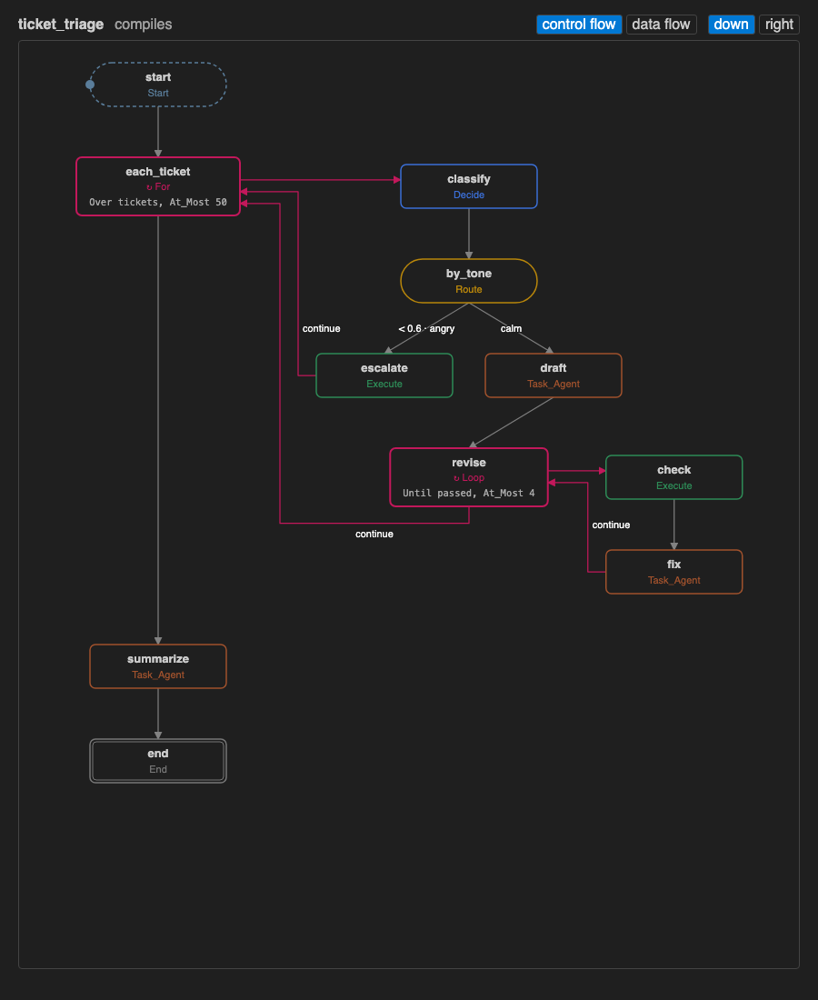

# AIP language: editor support

A VS Code extension for `.aip` procedure files: a TextMate grammar for the colours (also for
` ```aip ` fences in Markdown), the compiler's diagnostics as squiggles, a graph preview beside
the text, and commands that compile, run, publish and import procedures. On open, on every
change and on save it runs `aip compile --check --json --stdin` on the file's folder with the
buffer's text, so an unsaved edit is checked against the folder's scripts and assets on disk,
and publishes every error, warning and info at the compiler's own line and column. A status-bar
item shows the compiler's version (`aip 0.9.0`), or "aip not found" with the install hint.

## The graph preview

**AIP: Open the graph preview to the side** (the button in the editor's title bar, or
Cmd/Ctrl+K V, as for the Markdown preview) opens a pane beside the file drawing the procedure's
step graph as the console's procedure page draws it, from `console/src/graph` and
`console/src/views/StepGraph.tsx`, bundled into the extension. Steps are nodes with their kind;
a `For` or a `Loop` is a node of its own with its body hung beside it, the arrow in to the first
step of the body and `Continue` back to the loop; a route's branches are labelled. The toolbar
switches between **control flow** and **data flow** (the control edges faint, and the arrows of
the key picked above the graph, or of the step clicked: who produces it, who reads it), and
draws **down** or **right**. There is no run traffic: the editor has no server. It is drawn
from the graph the same check prints, so it redraws on every change, a few hundred milliseconds
after the last keystroke. While the buffer has errors the compiler prints no graph: the preview
keeps the last one that compiled, says so, and names the first error (click it to go there).
Click a step or a loop and the cursor goes to it.



## Commands

| Command | What it does |
|---|---|
| **AIP: Open the graph preview to the side** | the preview above |
| **AIP: Compile the procedure (write its bundle)** | saves the file and types `aip compile <folder>` into the AIP terminal |
| **AIP: Run the procedure in the terminal** | asks for the Start step's inputs as JSON (prefilled with every input, empty), writes them to a file in the temp directory and types `aip run <folder> -i @<file>` |
| **AIP: Publish the procedure to the server** | saves the file and types `aip publish <folder>` |
| **AIP: Import a procedure from the catalog** | asks for a published `name` or `name@rev` and a folder, runs `aip get <ref> --out <folder>/<name>` and opens its `procedure.aip` |
| **AIP: Check the procedure** | checks the active file now |
| **AIP: Show the compiler's version** | the version line, or the install hint when `aip` is not found; also what clicking the status-bar item does |

The terminal commands run in the procedure's folder, in a terminal named AIP that they reuse, so
a run's pause can be answered there with `aip resume`. They use the `aip.command` setting's
words. The compiler's stderr, when it fails to answer, goes to the **AIP** output channel.

## Build

```
cd editors/vscode
npm install
npm run build          # esbuild: dist/extension.js, and dist/preview.js + preview.css for the preview
npm test               # the tokenizer, the diagnostics, the preview and the terminal lines
npm run package        # aip-lang.vsix, for code --install-extension
```

The tests run the real compiler: `aip` on PATH, or the words in `AIP_COMMAND` (from a checkout,
`uv run aip`, the default). `npm run watch` rebuilds on every change. The preview's bundle
includes the step graph from `../../console/src` and React from this folder's
`node_modules` (`one-react.mjs` sees that there is one copy); `console/` needs no `npm install`
for it.

## VS Code, Cursor, Windsurf

Package and install the `.vsix`:

```
npm run package
code --install-extension aip-lang.vsix           # Cursor: cursor --install-extension
```

Or, while working on the extension, build and symlink this folder into the editor's extensions
directory, then reload the window:

```
ln -s "$(pwd)" ~/.vscode/extensions/aip-lang      # Cursor: ~/.cursor/extensions
```

It is not on the marketplace yet.

## The file icon

`.aip` files show the icon in `icons/` (light and dark), declared on the language, in the
explorer and on the tab with icon themes that use language icons, Seti (the default) among them.
Material Icon Theme draws its own icon for every file, so map `.aip` there in `settings.json`,
to one of its icons:

```json
"material-icon-theme.files.associations": { "*.aip": "graphql" }
```

or to this extension's SVG, by a path relative to the theme's `dist` folder (its README,
"Custom SVG icons"), e.g. `"*.aip": "../../zach-blumenfeld.aip-lang-0.3.1/icons/aip-dark"`.

## Settings

| Setting | Default | What it is |
|---|---|---|
| `aip.command` | `aip` | the command the extension runs: a name on PATH, a path, or several words such as `uv run aip` |
| `aip.debounceMs` | `300` | how long after the last edit the procedure is checked (and the preview redrawn) |

## PyCharm and other JetBrains IDEs

Settings → Editor → TextMate Bundles → `+` → this folder gives the colors but not folding or
diagnostics: JetBrains IDEs do not fold TextMate-defined languages, and the diagnostics are the
VS Code extension's. A JetBrains custom file type was tried and dropped (2026-11-06); folding
there needs a native plugin.

## Sublime Text

Copy `syntaxes/aip.tmLanguage.json` into `Packages/User/`; Sublime converts it on load.

## Colors

The extension ships its own colors for its scopes (`contributes.configurationDefaults` in
`package.json`), so every theme shows the same scheme: step verbs bold and in the highest-contrast
color on the page, step names plain, every clause (`Read`, `Produce`, `Next_Step`, loop words,
`With`) in one blue, types teal, keys yellow, named strings green, labels and paths red, `{field}`
placeholders italic. A light-theme variant applies to themes whose name contains "Light". To
change a color, override the scope in your own `settings.json` under
`editor.tokenColorCustomizations.textMateRules`; user settings win over the extension's defaults.

## What it colors

Step verbs (`Decide`, `Route`, `Execute`, `Task_Agent`, `Start`, `End`, `Procedure`, `For`,
`Loop`) and the step name after them; clauses (`Read`, `Produce`, `Next_Step`, `Answer_Questions`,
`Run_Script`, `Use`, `Prompt`, `Confidence_Below`, loop words); `->` and branch
labels; types; `key: type` declarations; `name = "..."` named strings; `decision.question` field
access; `{field}` placeholders inside strings; comments; numbers and `true`/`false`. Keywords match
in any case, as the compiler accepts them. `test/grammar.test.js` runs the grammar through
vscode-textmate over the example programs and asserts these scopes.

## Layout

| Path | What |
|---|---|
| `src/compiler.js` | runs the compiler, parses its report into ranges, reads its version; no `vscode` import, so node tests it |
| `src/extension.js` | the activation: documents, debounce, the diagnostic collection, the status bar, the preview panels, the commands |
| `src/preview.js` | the preview's page and the state posted to it after each check (the last graph that compiled kept through errors); no `vscode` import |
| `src/terminal.js` | the command lines typed into the terminal, the import's folder, the run's inputs template; no `vscode` import |
| `src/webview/` | the preview's page: `Preview.tsx` (the step graph and the toolbar above it, no `vscode`), `main.tsx` (the webview's messages), `page.css` (the editor's theme and the palette the graph reads) |
| `esbuild.mjs`, `one-react.mjs` | the build; `dist/extension.js` is what `package.json`'s `main` names, `dist/preview.js` and `preview.css` what the preview loads (not committed) |
| `icons/` | the `.aip` file icon, light and dark |
| `syntaxes/` | the grammar and the Markdown injection |
| `docs/` | a picture of the preview |
| `test/` | `compiler.test.js` (against `test/fixtures/one-error`, a procedure with one error), `grammar.test.js` (the tokenizer harness), `preview.test.js` (the preview rendered on the server over the compiler's graph: ticket-triage's loops as nodes with their bodies beside them, the data-flow toggle, and the `Next_Step` edit that redraws an arrow), `terminal.test.js` |
